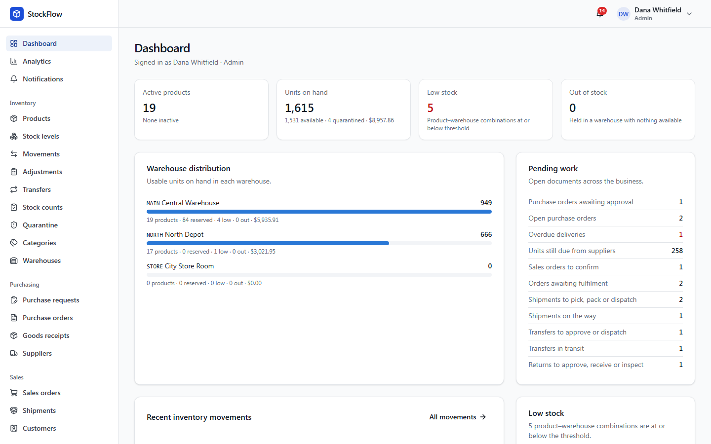
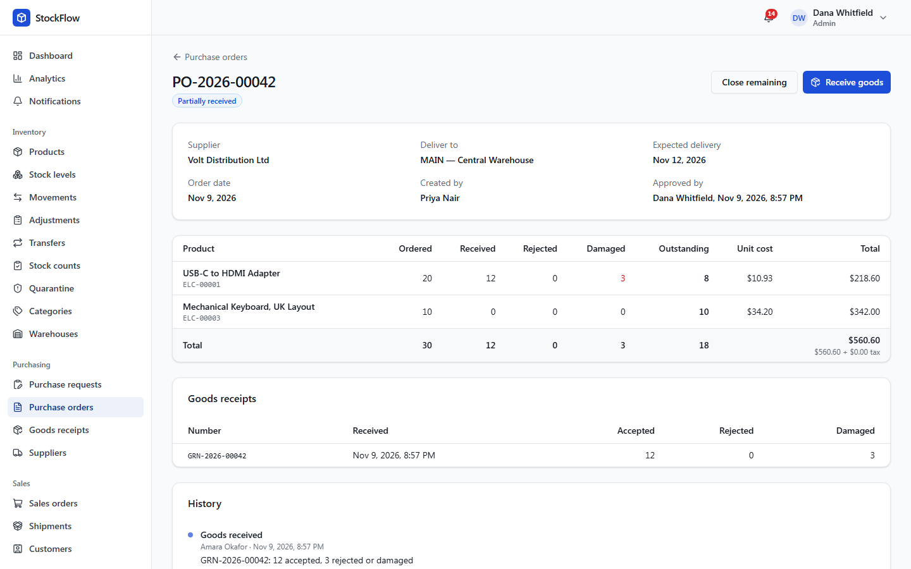
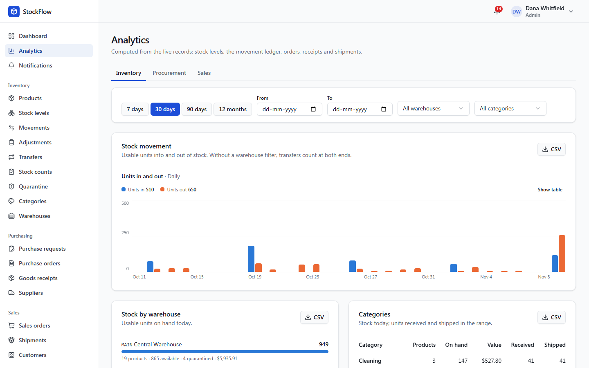
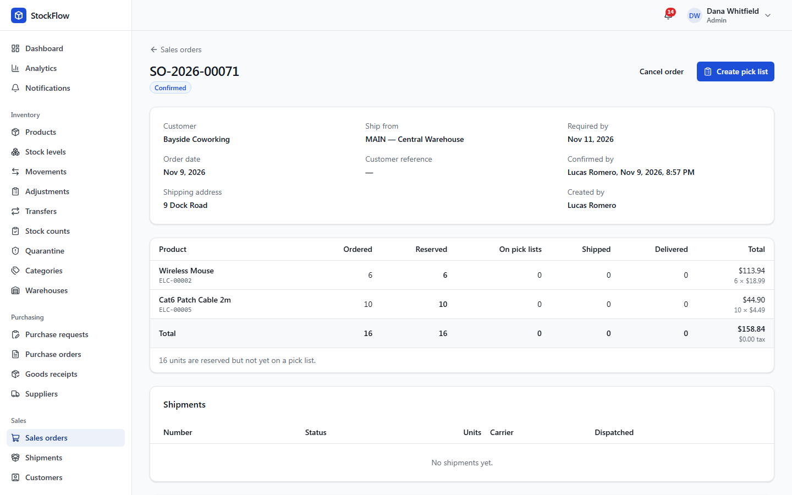
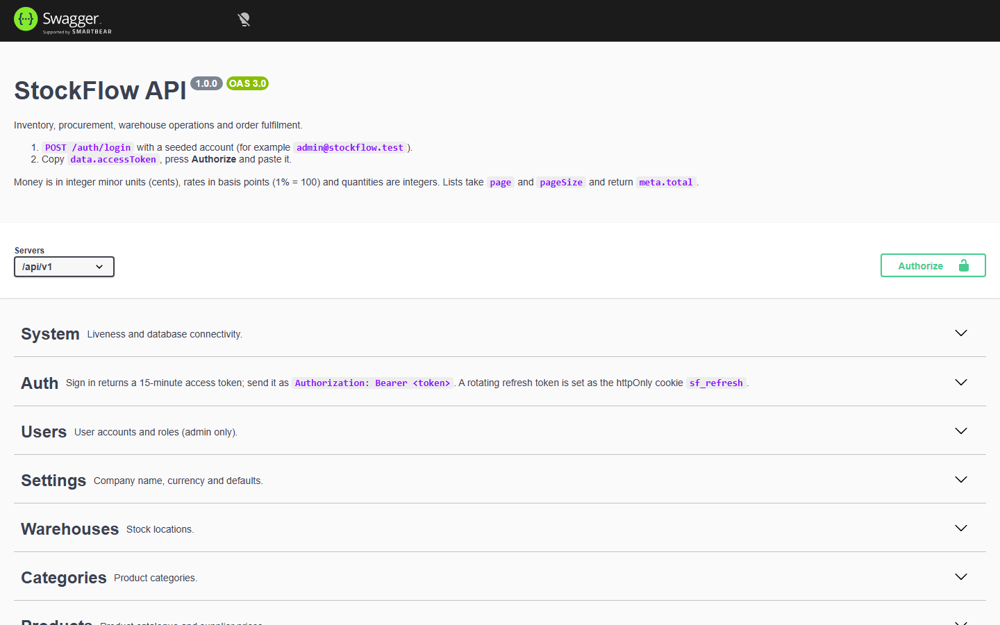
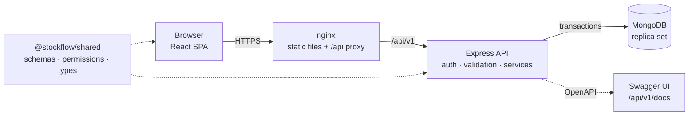
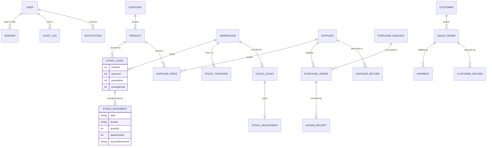
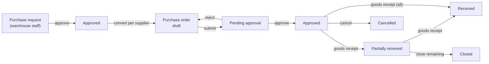
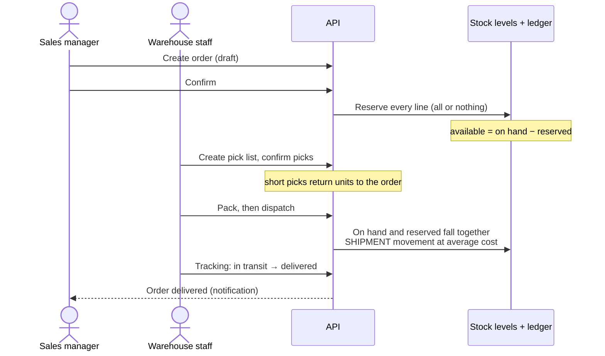

# StockFlow

**Inventory, procurement, warehouse operations and order fulfilment for a business with several warehouses and a team of people with different jobs.** Full-stack TypeScript: MongoDB, Express, React and Node.



**Contents:**

- [Overview](#overview)
- [Features](#features)
- [Technology](#technology)
- [Architecture](#architecture)
- [Data model](#data-model)
- [Workflows](#workflows)
- [Quick start with Docker](#quick-start-with-docker)
- [Local development](#local-development)
- [Environment variables](#environment-variables)
- [Demo guide](#demo-guide)
- [API documentation](#api-documentation)
- [Testing](#testing)
- [Deployment](#deployment)
- [Project structure](#project-structure)
- [Business rules](#business-rules)
- [Troubleshooting](#troubleshooting)
- [Scope](#scope)

## Overview

Small and mid-sized businesses often run stock on spreadsheets: nobody is sure what's really available, two people sell the last unit, deliveries arrive short and the numbers drift. StockFlow keeps one consistent record of every unit, from the purchase order that brought it in to the shipment that sent it out.

**Objectives:**

- **Stock you can trust.** Every change to a quantity writes an entry in an append-only ledger in the same database transaction, so the ledger always equals the balance. Concurrent requests can't oversell.
- **Real workflows.** Requests, approvals, partial deliveries, short picks, transfers in transit, counts and returns, each with a status, a history and a person accountable.
- **Right access for each job.** Five roles with permissions enforced by the API and reflected in the interface.
- **Decisions from live data.** The dashboard, analytics and CSV exports are computed from the records, not maintained separately.

## Features

| Area                      | What you can do                                                                                                                                                                                                        |
| ------------------------- | ---------------------------------------------------------------------------------------------------------------------------------------------------------------------------------------------------------------------- |
| **Inventory**             | Products with generated SKUs, categories and warehouses; stock per product × warehouse (on hand, reserved, available, quarantined); low-stock thresholds per warehouse; the movement ledger; adjustments and reversals |
| **Procurement**           | Purchase requests → approval → purchase orders per supplier → approval → goods receipts with accepted, rejected and damaged quantities; partial deliveries; supplier price lists and delivery performance              |
| **Order fulfilment**      | Sales orders with discounts and availability checks; confirming reserves stock all or nothing; pick lists, short picks, packing, dispatch, tracking and delivery; cancellation releases reservations                   |
| **Warehouse operations**  | Transfers with approval, dispatch, partial receipt and close-short; physical counts with blind counting and reasoned variances; quarantine for damaged and returned goods                                              |
| **Returns**               | Customer returns received into quarantine, then inspected and restocked or written off; supplier returns from usable or quarantined stock                                                                              |
| **Dashboard & analytics** | Pending work across the business; inventory, procurement and sales analytics with date ranges, filters and CSV export; fast and slow movers; supplier on-time rates; fulfilment times                                  |
| **Notifications**         | Approvals waiting for you, updates on documents you're involved in, and low-stock alerts                                                                                                                               |
| **Administration**        | Users and roles, forced password change, session revocation, an audit log of every change and sign-in attempt                                                                                                          |
| **API**                   | REST API under `/api/v1` with interactive Swagger documentation generated from the live routes                                                                                                                         |

<table>
  <tr>
    <td></td>
    <td></td>
  </tr>
  <tr>
    <td align="center">A purchase order part-received, with damaged units quarantined</td>
    <td align="center">Stock movement over the last 30 days</td>
  </tr>
  <tr>
    <td></td>
    <td></td>
  </tr>
  <tr>
    <td align="center">A confirmed sales order with its reservations</td>
    <td align="center">Interactive API documentation</td>
  </tr>
</table>

More in [docs/screenshots](docs/screenshots): products, stock levels, shipments, transfers, sales analytics, the audit log, the sign-in page and the phone layout.

## Technology

| Layer    | Technology                                                                                                        |
| -------- | ----------------------------------------------------------------------------------------------------------------- |
| Frontend | React 19, TypeScript, Vite, Tailwind CSS 4, shadcn/ui (Radix), TanStack Query, React Router                       |
| Backend  | Node.js 22, Express 5, Mongoose 8, Zod 4, JSON Web Tokens, bcrypt, helmet, pino                                   |
| Database | MongoDB 8 as a replica set (multi-document transactions)                                                          |
| Shared   | `@stockflow/shared`: roles, permissions, Zod request schemas, response types and money helpers used by both sides |
| API docs | OpenAPI 3 generated from the Express routers and Zod schemas, served with Swagger UI                              |
| Testing  | Vitest, Supertest, mongodb-memory-server, Testing Library, Playwright                                             |
| Delivery | Docker multi-stage images, nginx, Docker Compose, GitHub Actions, GitHub Container Registry                       |

## Architecture



- **One origin.** nginx serves the built React app and proxies `/api` to the API, so there's no CORS and the refresh cookie stays `SameSite=Strict`.
- **The backend owns the business logic.** The browser uses the shared Zod schemas only to show errors early and preview totals; the API validates every request again and recalculates.
- **Inventory consistency.** Only the stock service writes quantities. Every write is a conditional update (for example "on hand − reserved ≥ quantity") inside a transaction that also inserts the ledger entry and updates the source document, so concurrent requests can't oversell and a failure leaves nothing half-done.
- **Authentication.** Signing in returns a 15-minute access token held in memory, plus a rotating refresh token in an httpOnly cookie. Reusing an old refresh token revokes the session. Every request reloads the user, so deactivation and role changes apply immediately.

The design document, [docs/ARCHITECTURE.md](docs/ARCHITECTURE.md), covers every collection, invariant, endpoint and decision in depth.

## Data model



- Documents embed their line items and keep snapshots of names (product, customer, supplier, user), so history reads correctly after a rename.
- Money is stored in integer minor units, rates in basis points and quantities as integers: no floating-point rounding.
- Document numbers such as `PO-2026-00042` come from an atomic counter inside the posting transaction.

## Workflows

### Procurement



A goods receipt records accepted, rejected and damaged units per line. Only accepted units enter usable stock, at the order price, updating the moving average cost. Damaged units go to quarantine. Outstanding = ordered − accepted.

### Sales fulfilment



Cancelling releases every unshipped reservation. Customer returns come back into quarantine and are restocked at the cost they shipped at once inspected.

## Quick start with Docker

The fastest way to run everything: MongoDB, the API and the web app, with demo data. You need [Docker Desktop](https://www.docker.com/products/docker-desktop/) (or Docker Engine with Compose v2) running.

```bash
git clone <your-repository-url> stockflow
cd stockflow
cp .env.example .env
```

Open `.env` and set `JWT_ACCESS_SECRET` to a random string of at least 32 characters. To generate one (Node.js required):

```bash
node -e "console.log(require('crypto').randomBytes(48).toString('base64url'))"
```

Then build, start and load the demo data:

```bash
docker compose up -d --build --wait
docker compose run --rm seed
```

Open **http://localhost:8080** and sign in as `admin@stockflow.test` with the password `StockFlow-Demo-2026` (see the [demo guide](#demo-guide)). The API documentation is at http://localhost:8080/api/v1/docs.

| Command                        | What it does                                              |
| ------------------------------ | --------------------------------------------------------- |
| `docker compose ps`            | Show the services and their health                        |
| `docker compose logs -f api`   | Follow the API logs                                       |
| `docker compose run --rm seed` | Erase the database and reload the demo data               |
| `docker compose down`          | Stop everything (data is kept in the `mongo-data` volume) |
| `docker compose down -v`       | Stop everything and delete the data                       |

Without the demo data, set `BOOTSTRAP_ADMIN_EMAIL` and `BOOTSTRAP_ADMIN_PASSWORD` in `.env` before the first start. That admin is created on the empty database and must choose a new password at first sign-in.

## Local development

### Option A: Node.js on your machine (recommended for development)

Requires **Node.js 20.19 or later** (22 LTS recommended).

```bash
npm install
cp apps/api/.env.example apps/api/.env
```

Set `JWT_ACCESS_SECRET` in `apps/api/.env` (same generator as above). MongoDB has to run as a replica set; choose one:

```bash
npm run db:local
```

That downloads a MongoDB binary on first run and keeps the data in `apps/api/.data`; leave it running in its own terminal. Alternatively, with Docker:

```bash
docker compose -f docker-compose.dev.yml up -d mongo
```

Then, in another terminal:

```bash
npm run seed
npm run dev
```

The web app runs on **http://localhost:5173** with hot reload and proxies `/api` to the API on port 4000. Swagger UI is at http://localhost:5173/api/v1/docs.

### Option B: everything in Docker, with hot reload

```bash
docker compose -f docker-compose.dev.yml up
docker compose -f docker-compose.dev.yml run --rm seed
```

This runs the source from your folder: the API restarts and the browser updates when you save. Dependencies are installed inside the containers on the first start, which takes a few minutes. The web app is on http://localhost:5173. Stop it with `docker compose -f docker-compose.dev.yml down`.

## Environment variables

**`.env` in the repository root** (read by `docker-compose.yml`; see [.env.example](.env.example)):

| Variable                                            | Required | Default               | Purpose                                                                                                 |
| --------------------------------------------------- | -------- | --------------------- | ------------------------------------------------------------------------------------------------------- |
| `JWT_ACCESS_SECRET`                                 | Yes      | none                  | Signs access tokens. At least 32 random characters; changing it signs everyone out.                     |
| `WEB_PORT`                                          | No       | `8080`                | Port for the web app and `/api`                                                                         |
| `MONGO_PORT`                                        | No       | `27018`               | MongoDB published on 127.0.0.1 only, for tools such as Compass                                          |
| `COOKIE_SECURE`                                     | No       | `true`                | Secure refresh cookie. Works on `localhost` and HTTPS; set `false` only for plain HTTP on another host. |
| `API_DOCS`                                          | No       | `true`                | Serve Swagger UI and `/api/v1/openapi.json`                                                             |
| `LOGIN_RATE_LIMIT`                                  | No       | `10`                  | Sign-in attempts per 15 minutes per IP and per email                                                    |
| `BOOTSTRAP_ADMIN_EMAIL`, `BOOTSTRAP_ADMIN_PASSWORD` | No       | none                  | First admin, created only when there are no users                                                       |
| `BOOTSTRAP_ADMIN_NAME`                              | No       | `Administrator`       | Display name for that admin                                                                             |
| `SEED_PASSWORD`                                     | No       | `StockFlow-Demo-2026` | Password for the demo accounts                                                                          |
| `API_IMAGE`, `WEB_IMAGE`                            | No       | local build           | Prebuilt images, for example from GHCR                                                                  |

**`apps/api/.env`** (Node.js development; see [apps/api/.env.example](apps/api/.env.example)) also accepts `MONGODB_URI`, `PORT`, `ACCESS_TOKEN_TTL_SECONDS` (900), `REFRESH_TOKEN_TTL_DAYS` (7), `BCRYPT_ROUNDS` (12), `CORS_ORIGINS` (only for calling the API from another origin), `TRUST_PROXY` and `LOG_LEVEL`. The API refuses to start, naming the problem, if a value is missing or invalid.

## Demo guide

`npm run seed` or `docker compose run --rm seed` erases the database and loads a realistic company: three warehouses, 19 products in five categories, four suppliers and five customers.

- **History:** about 12 weeks of trading, with weekly supplier deliveries (some late) and customer orders picked, packed, dispatched and delivered, so the analytics have something to show.
- **Open work today:** a purchase order awaiting approval, one part-received with damaged goods, an overdue delivery, orders at every fulfilment stage, transfers in transit and awaiting approval, a return waiting for inspection, quarantined stock and a count in progress.

Everything is created through the same services the API uses, so stock, reservations and the ledger agree.

Every account uses the password **`StockFlow-Demo-2026`** (or `SEED_PASSWORD`):

| Sign in as                   | Role                | Sees                                                           |
| ---------------------------- | ------------------- | -------------------------------------------------------------- |
| `admin@stockflow.test`       | Admin               | Everything, plus users, settings and the audit log             |
| `inventory@stockflow.test`   | Inventory Manager   | Stock, adjustments, transfers, counts, quarantine, returns     |
| `procurement@stockflow.test` | Procurement Manager | Suppliers, purchase requests and orders, procurement analytics |
| `sales@stockflow.test`       | Sales Manager       | Customers, sales orders, shipments, sales analytics            |
| `staff@stockflow.test`       | Staff               | Receiving, picking, packing and dispatch                       |

**A five-minute tour:**

1. **Dashboard** (admin): the pending-work list links to every open item; low stock shows 5 product–warehouse combinations.
2. **Purchase orders → the "Partially received" order:** 12 of 20 adapters accepted, 3 damaged into quarantine. Press **Receive goods** to receive the rest and watch the stock level and ledger change.
3. **Sales orders → a confirmed order:** see its reservations, create a pick list, confirm the pick, pack and dispatch. On-hand stock falls only at dispatch.
4. **Try to oversell:** create an order for more keyboards than are available and confirm it. The API refuses and lists the short lines.
5. **Transfers:** sign in as `inventory@stockflow.test`, approve the waiting transfer, then receive the one in transit, marking a unit damaged.
6. **Analytics:** switch between 30 days, 90 days and 12 months, filter by warehouse and export a table to CSV.
7. **Roles:** sign in as `staff@stockflow.test`; the menu shrinks to the jobs that role does, and other pages say access denied.
8. **Audit log** (admin): every change you made above, with who, when and the outcome.

To refresh the screenshots after UI changes, run this against a seeded stack:

```bash
SCREENSHOT_BASE_URL=http://localhost:8080 npm run screenshots -w @stockflow/web
```

## API documentation

- **Swagger UI:** `/api/v1/docs`, for example http://localhost:8080/api/v1/docs.
- **OpenAPI 3 document:** `/api/v1/openapi.json`.

The document is generated at startup from the mounted Express routers and the same Zod schemas that validate requests. Each operation lists the permission it needs and which roles hold it. A test fails if a route is added without documentation or if a documented permission isn't enforced.

To try a request: call `POST /auth/login` with a demo account, copy `data.accessToken`, press **Authorize** and paste it.

Conventions:

- Responses are `{ data }`, or `{ data, meta: { page, pageSize, total } }` for lists.
- Errors are `{ error: { code, message, details? } }`, where `details` gives the field path, such as `lines.2.quantity`.
- Report tables accept `format=csv`.

## Testing

```bash
npm run lint            # ESLint
npm run typecheck       # TypeScript in every workspace
npm run format:check    # Prettier
npm test                # unit, integration and component tests
npm run build           # shared → api → web
```

End-to-end tests need the Playwright browser once:

```bash
cd apps/web && npx playwright install chromium && cd ../..
npm run test:e2e
```

| Suite                                                                | Count | Covers                                                                                                                                              |
| -------------------------------------------------------------------- | ----: | --------------------------------------------------------------------------------------------------------------------------------------------------- |
| Shared unit (Vitest)                                                 |    21 | Money and tax rounding, order totals, average cost, permission map                                                                                  |
| API integration (Vitest + Supertest + in-memory MongoDB replica set) |   173 | Every workflow over HTTP, concurrency (parallel requests competing for the last units), reports against known figures, security, OpenAPI, demo seed |
| Web unit and component (Vitest + Testing Library)                    |    30 | Charts, form validation, dialogs, route guards, notification bell                                                                                   |
| End to end (Playwright)                                              |    38 | Sign-in and roles, procurement, fulfilment, inventory, transfers, analytics, users; no horizontal scrolling at phone and tablet widths              |

After every test that touches stock, a helper checks the core invariant: each bucket's ledger equals its balance, reservations equal what open orders hold, and every shipment, transfer and return matches its movements.

The same browser suite can run against any running stack, for example the production Docker images:

```bash
E2E_BASE_URL=http://localhost:8080 npx playwright test   # from apps/web; seed with SEED_PASSWORD=e2e-demo-password
```

**Continuous integration** ([.github/workflows/ci.yml](.github/workflows/ci.yml)) runs on every push and pull request:

1. Lint, format check, typecheck, all tests, build and the end-to-end suite.
2. The production Docker images built and started with Compose, seeded, smoke-tested through nginx, and the whole browser suite run against them.
3. On pushes to `main` and version tags `v*`, both images published to the GitHub Container Registry.

## Deployment

StockFlow runs anywhere Docker runs: a VPS, a cloud VM or an on-premises server. The steps for a Linux server with Docker Engine and Compose v2:

**1. Get the code and configure it**

```bash
git clone <your-repository-url> stockflow && cd stockflow
cp .env.example .env
```

In `.env`: set `JWT_ACCESS_SECRET` (a new random value), `BOOTSTRAP_ADMIN_EMAIL` and `BOOTSTRAP_ADMIN_PASSWORD` for the first admin, and `WEB_PORT=8080`. Keep `COOKIE_SECURE=true` and serve over HTTPS (step 3).

**2. Start it**

Build on the server:

```bash
docker compose up -d --build --wait
```

Or use the images CI publishes. Set these in `.env`, replacing `<owner>` with your GitHub user or organisation:

```bash
API_IMAGE=ghcr.io/<owner>/stockflow-api:latest
WEB_IMAGE=ghcr.io/<owner>/stockflow-web:latest
```

Then:

```bash
docker compose pull api web && docker compose up -d --no-build --wait
```

Packages are private by default on GitHub; make them public or run `docker login ghcr.io` on the server first.

**3. Put HTTPS in front**

Point a domain at the server and run a TLS-terminating reverse proxy to `localhost:8080`. With [Caddy](https://caddyserver.com/), which obtains certificates automatically, the whole `Caddyfile` is:

```
stockflow.example.com {
    reverse_proxy localhost:8080
}
```

The API trusts one proxy hop (`TRUST_PROXY=1`), so rate limits and the audit log see the real client IP.

**4. Operate it**

| Task    | Command                                                                                               |
| ------- | ----------------------------------------------------------------------------------------------------- |
| Health  | `curl https://stockflow.example.com/api/v1/health` → `{"data":{"status":"ok","database":"up"}}`       |
| Logs    | `docker compose logs -f api` (JSON lines, rotated at 10 MB × 3)                                       |
| Back up | `docker compose exec mongo mongodump --archive --gzip > stockflow-$(date +%F).archive.gz`             |
| Restore | `docker compose exec -T mongo mongorestore --archive --gzip --drop < stockflow-2026-11-09.archive.gz` |
| Upgrade | `git pull && docker compose up -d --build --wait` (or `docker compose pull` with prebuilt images)     |

Don't run the `seed` service in production: it erases the database. The seed script refuses to run with `NODE_ENV=production` unless that service's explicit `SEED_CONFIRM=reset` is set.

**Managed MongoDB (Atlas or similar)**

Remove the `mongo` service and set `MONGODB_URI` on the `api` service to your connection string. Atlas clusters are replica sets, so transactions work.

## Project structure

```
stockflow/
├── apps/
│   ├── api/                    Express API
│   │   ├── src/
│   │   │   ├── app.ts          middleware and the router list (also feeds the OpenAPI document)
│   │   │   ├── config/         environment validation, database, logger
│   │   │   ├── lib/            errors, transactions, counters, pagination
│   │   │   ├── middleware/     authentication, permissions, error handling
│   │   │   └── modules/        one folder per feature: routes, services, models
│   │   ├── scripts/            seed, demo history, local MongoDB, E2E server
│   │   └── tests/              Supertest integration tests and fixtures
│   └── web/                    React app
│       ├── src/
│       │   ├── app/            router, navigation, layout
│       │   ├── components/     shared UI (shadcn/ui in components/ui)
│       │   ├── features/       one folder per feature: pages and query hooks
│       │   └── lib/            API client, query helpers, formatting
│       ├── e2e/                Playwright specs
│       └── scripts/            README screenshot capture
├── packages/shared/            roles, permissions, Zod schemas, DTO types, money helpers
├── docs/                       ARCHITECTURE.md and screenshots
├── docker-compose.yml          production-style stack
├── docker-compose.dev.yml      development stack with hot reload
└── .github/workflows/ci.yml    CI and image publishing
```

## Business rules

<details>
<summary><strong>Inventory</strong></summary>

- Every change to a stock quantity writes a movement in the same MongoDB transaction; the ledger always sums to the balance.
- Available = on hand − reserved. Withdrawals can't take available stock below zero, even under concurrent requests.
- Opening stock can be registered once per product per warehouse, before any other movement there. Later corrections are adjustments.
- Low stock: available ≤ threshold in a warehouse that holds the product. The threshold is the product's, or a per-warehouse override.
- Leaving the SKU blank generates `<category code>-00001`; SKUs can't be changed afterwards.
- Movements are never deleted. A posted adjustment is reversed by a new one with the opposite quantities, linked both ways.

</details>

<details>
<summary><strong>Procurement</strong></summary>

- Purchase requests → approval → purchase order for a chosen supplier → approval → goods receipts. Nobody approves their own request or order unless they're an admin.
- Order lines default to the supplier's price, else the product's cost price; the expected date defaults from the supplier's lead time.
- Each receipt line records accepted, rejected and damaged quantities. Only accepted units enter stock; rejected and damaged units remain outstanding.
- Orders can be cancelled until the first receipt; after that, "close remaining" ends what's outstanding.

</details>

<details>
<summary><strong>Fulfilment</strong></summary>

- Lines default to the product's selling price, with an optional per-line discount; tax applies after the discount.
- Confirming reserves every line, all or nothing, and is refused with the short lines listed when stock isn't enough. There are no backorders.
- Short picks need a reason and return the units to the order, still reserved. Picking and packing don't change stock; dispatch does, at the current average cost.
- Tracking updates build the delivery timeline. The order is delivered when everything shipped has been delivered.
- Cancelling releases all unshipped reservations and cancels open pick lists. After a partial shipment, only the remainder is cancelled.

</details>

<details>
<summary><strong>Warehouse operations and returns</strong></summary>

- **Transfers:** approved by someone other than the requester. Stock leaves the source at dispatch and is in neither warehouse while in transit. Receipts can be partial; damaged units go to the destination's quarantine. What never arrives is closed short and written off as a loss.
- **Counts:** cover every active product in a warehouse, or one category; counting is blind by default. Variances are measured against on hand at posting and each needs a reason. One open count per warehouse.
- **Quarantine:** a second balance for damaged goods and returns awaiting inspection. It's never available to sell; units leave by release, write-off or a supplier return.
- **Customer returns:** limited to what was shipped, received into quarantine, then inspected; restocked units return at the cost they shipped at.
- **Supplier returns:** from quarantine or usable stock, approved by procurement; stock leaves at dispatch.

</details>

## Troubleshooting

| Symptom                                                                         | Fix                                                                                                                                      |
| ------------------------------------------------------------------------------- | ---------------------------------------------------------------------------------------------------------------------------------------- |
| `required variable JWT_ACCESS_SECRET is missing a value`                        | Create `.env` from `.env.example` and set `JWT_ACCESS_SECRET` (see [Quick start](#quick-start-with-docker)).                             |
| `ports are not available` / `address already in use` for 8080                   | Another program uses the port. Set `WEB_PORT=8088` (or any free port) in `.env` and open that port instead.                              |
| `Bind for 127.0.0.1:27017 failed` (dev stack)                                   | A local MongoDB is running. Stop it, or set `MONGO_DEV_PORT=27019` for `docker-compose.dev.yml`.                                         |
| Docker commands fail with `cannot find the file specified` / engine pipe errors | Docker Desktop isn't running. Start it and wait until it reports the engine is running.                                                  |
| API exits with `Invalid environment configuration`                              | The message names the variable: usually `JWT_ACCESS_SECRET` shorter than 32 characters or a missing `MONGODB_URI`.                       |
| `Transaction numbers are only allowed on a replica set member`                  | MongoDB is running standalone. Use `npm run db:local`, the compose `mongo` service, or start `mongod --replSet rs0` and `rs.initiate()`. |
| Signed out straight after signing in, over plain HTTP on a LAN address          | Browsers drop secure cookies on non-localhost HTTP. Use HTTPS, or set `COOKIE_SECURE=false` for that test setup only.                    |
| Too many sign-in attempts                                                       | The limit resets after 15 minutes; raise `LOGIN_RATE_LIMIT` for demos with many sign-ins.                                                |

## Scope

StockFlow serves one business (one tenant) with many users and warehouses. Invoices, payments, payment status, refunds and credit notes, backorders and external identity providers are out of scope: order prices and totals are informational, and returns move goods, not money. Implementation history and test results per phase are in [IMPLEMENTATION_LOG.md](IMPLEMENTATION_LOG.md).
