# StockFlow Architecture

StockFlow is an inventory, procurement, warehouse operations and order fulfilment system for one business workspace with multiple users and warehouses.

Contents

1. [Business requirements and roles](#1-business-requirements-and-roles)
2. [Workflows](#2-workflows)
3. [Data model](#3-data-model)
4. [Inventory calculations and consistency rules](#4-inventory-calculations-and-consistency-rules)
5. [Authentication and authorisation](#5-authentication-and-authorisation)
6. [Backend architecture and API](#6-backend-architecture-and-api)
7. [Frontend architecture](#7-frontend-architecture)
8. [Folder structure](#8-folder-structure)
9. [Testing, infrastructure and operations](#9-testing-infrastructure-and-operations)
10. [Key technical decisions](#10-key-technical-decisions)
11. [Implementation roadmap](#11-implementation-roadmap)

---

## 1. Business requirements and roles

### 1.1 Scope

| Area             | In scope                                                                                              |
| ---------------- | ----------------------------------------------------------------------------------------------------- |
| Workspace        | One company: company profile, currency, tax defaults, document number prefixes                        |
| Users            | Email/password accounts created by an admin; five fixed roles                                         |
| Warehouses       | Multiple stock locations; stock tracked per product per warehouse                                     |
| Catalogue        | Categories and products (SKU, unit, prices, tax rate, reorder point)                                  |
| Inventory        | Stock levels, movement ledger, adjustments and reversals, physical counts, quarantine, low-stock list | \n  | Warehouse ops | Transfer requests with approval, dispatch, stock in transit, partial receipts | \n  | Returns | Customer returns with inspection and restocking; supplier returns from quarantine or usable stock |
| Procurement      | Suppliers, purchase orders with approval, goods receipts (partial)                                    |
| Order fulfilment | Customers, sales orders with stock reservation, pick lists, packing, dispatch, delivery tracking      |
| Reporting        | Dashboard, inventory valuation, purchasing and fulfilment summaries                                   |
| Audit            | Log of who changed what and when                                                                      |

### 1.2 Out of scope

These are excluded on purpose to keep the system focused:

- **Financial operations.** Supplier invoices, customer invoices, payment records, payment status tracking, reimbursement workflows and payment gateways. Order documents carry prices and totals so order values can be reported, but StockFlow does not bill, collect or pay.
- OAuth or external identity providers, self-service signup, multiple tenants.
- Multiple currencies. One workspace currency.
- Credit notes or refunds for returns (financial). Returns move goods only.
- Lot, serial and expiry tracking, bin locations, product variants, units-of-measure conversion.
- Backorders. A sales order can be confirmed only when the chosen warehouse has enough stock available.

### 1.3 Roles

The roles are fixed and defined in code. Each role maps to a set of permissions (see [§5.3](#53-permissions)).

| Role                    | Key                   | Responsibilities                                                                                                 |
| ----------------------- | --------------------- | ---------------------------------------------------------------------------------------------------------------- |
| **Admin**               | `admin`               | Complete system access, including users, workspace settings and the audit log                                    |
| **Inventory Manager**   | `inventory_manager`   | Products, categories, warehouses and stock: adjustments, transfers, goods receipts, shipments; inventory reports |
| **Procurement Manager** | `procurement_manager` | Suppliers and purchase orders, including approval; purchasing reports                                            |
| **Sales Manager**       | `sales_manager`       | Customers and sales orders; fulfilment reports                                                                   |
| **Staff**               | `staff`               | Restricted operational access: receive goods, ship sales orders, dispatch and receive transfers                  |

Every signed-in user can read master data (products, warehouses, suppliers, customers) and stock levels. Writes need a permission.

---

## 2. Workflows

### 2.1 Procurement

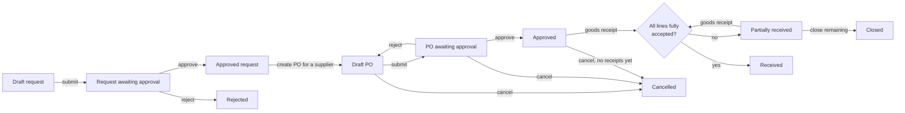

- **Purchase requests** are raised by staff, inventory or procurement and approved by procurement (not by the requester unless they're an admin). An approved request becomes a draft PO for the supplier chosen at conversion; deleting or cancelling that PO returns the request to approved.
- **Pricing:** PO lines default to the supplier's price list entry, else the product's cost price. The expected date defaults from the supplier's lead time.
- **Goods receipts** record accepted, rejected and damaged quantities per line. Only accepted units add to `onHand` (RECEIPT movements, moving average cost). Outstanding = ordered − accepted, so rejected and damaged units stay outstanding until redelivered or the PO is closed.
- **Cancel vs close:** a PO can be cancelled until its first receipt; after that, closing with a reason ends what's outstanding.
- **Supplier delivery history:** receipts carry the order's expected date, giving on-time/late counts and rejected/damaged rates per supplier.

### 2.2 Order fulfilment

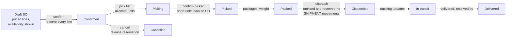

- **Pricing:** lines default to the product's selling price; each line can override the price and take a percentage discount. Tax is the product's rate, applied after the discount and rounded per line.
- **Availability:** the order form and draft detail show on-hand, reserved and available per warehouse for each line. Confirmation reserves every line in the order's warehouse, all or nothing, and reports each short line. There are no backorders.
- **Reservation:** confirming increments `reserved` with a conditional update (`onHand − reserved ≥ q`). Two orders confirmed at the same moment can't reserve the same units.
- **Pick lists (shipments):** a shipment allocates part or all of an order's unallocated quantity. Several shipments per order give partial fulfilment. Picking records what was actually taken; units that couldn't be picked go back to the order, still reserved, with a reason.
- **Physical stock changes only at dispatch.** Picking and packing move nothing in the ledger. Dispatch issues the picked units from the reservation: `onHand` and `reserved` fall together and `SHIPMENT` movements record the average cost at that moment.
- **Delivery tracking:** after dispatch, staff record in-transit, out-for-delivery, failed-attempt and delivered updates with time, location and note. Delivered needs the recipient's name and is final.
- **Order status** follows its lines: confirmed → partially shipped → shipped → delivered.
- **Cancellation:** cancelling releases every unshipped unit's reservation and cancels open pick lists. With nothing shipped the order becomes cancelled. After a partial shipment only the remainder is cancelled, and the order's status then reflects what shipped. A shipment can be cancelled before dispatch; its units return to the order, still reserved.
- **History:** orders and shipments record every action with who did it and when; an order's history includes each step of its shipments.

### 2.3 Inventory operations

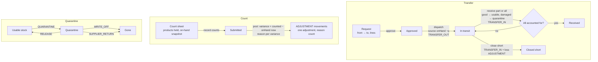

- **Transfers** need approval by someone other than the requester (admins excepted). Dispatch can send less than requested and is refused for more than is available at the source. Dispatched units are in neither warehouse until received; the transfer's lines track them (`dispatched − received − damaged − lost`). Receipts can be partial; damaged units go to the destination's quarantine. If the rest never arrives, closing short records it as received at the destination and writes it off in an adjustment (reason: loss) linked to the transfer.
- **Physical counts** cover every active product held in a warehouse, or one category. Counting is blind by default. One count per warehouse can be open at a time. Variances are measured against on-hand when posting, not when counting began, so stock that moved meanwhile isn't double-counted. Each variance needs a reason (damaged, lost, found, or miscount); a count below the reserved quantity is refused.
- **Quarantine** is a second balance per stock level. Quarantined units are physically present but never part of on-hand or available. Damaged stock, returns awaiting inspection and transfer damage go there; they leave by release, write-off or a supplier return.
- **Corrections never delete history.** A posted adjustment is corrected by a reversal: a new adjustment with the opposite quantities that links to the original, which is marked reversed. Opening stock is corrected with an adjustment; quarantine moves with the opposite action.

### 2.4 Returns

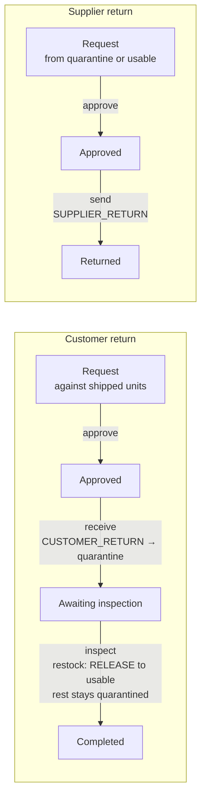

- A customer return can't exceed what shipped minus units already on active returns. The order line's `returnedQuantity` holds that count and is written in the same transaction, so concurrent requests can't over-return. Rejecting, cancelling or receiving fewer units frees the difference.
- Received units are isolated until inspected. Restocked units enter the average cost at the cost they shipped at.
- Supplier returns take each line from its source bucket at dispatch, priced from the linked purchase order where the product is on it.

### 2.5 Document state machines

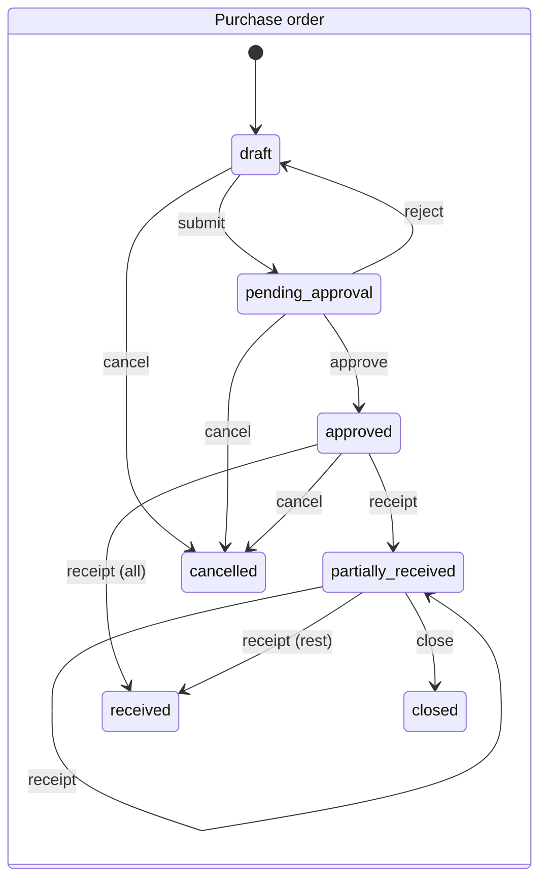

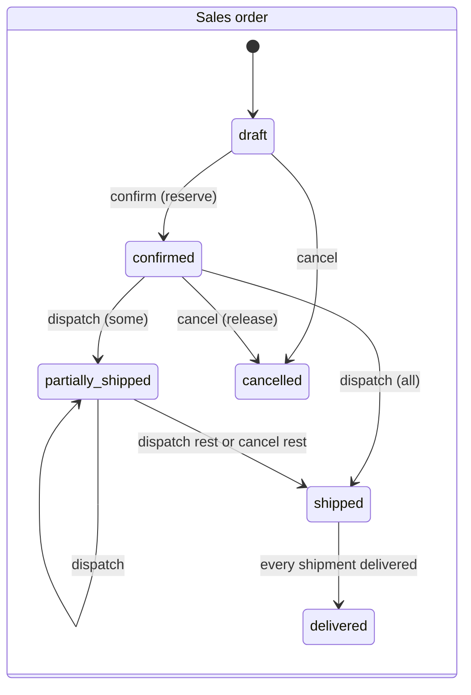

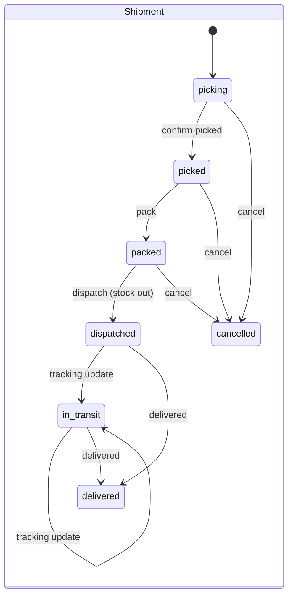

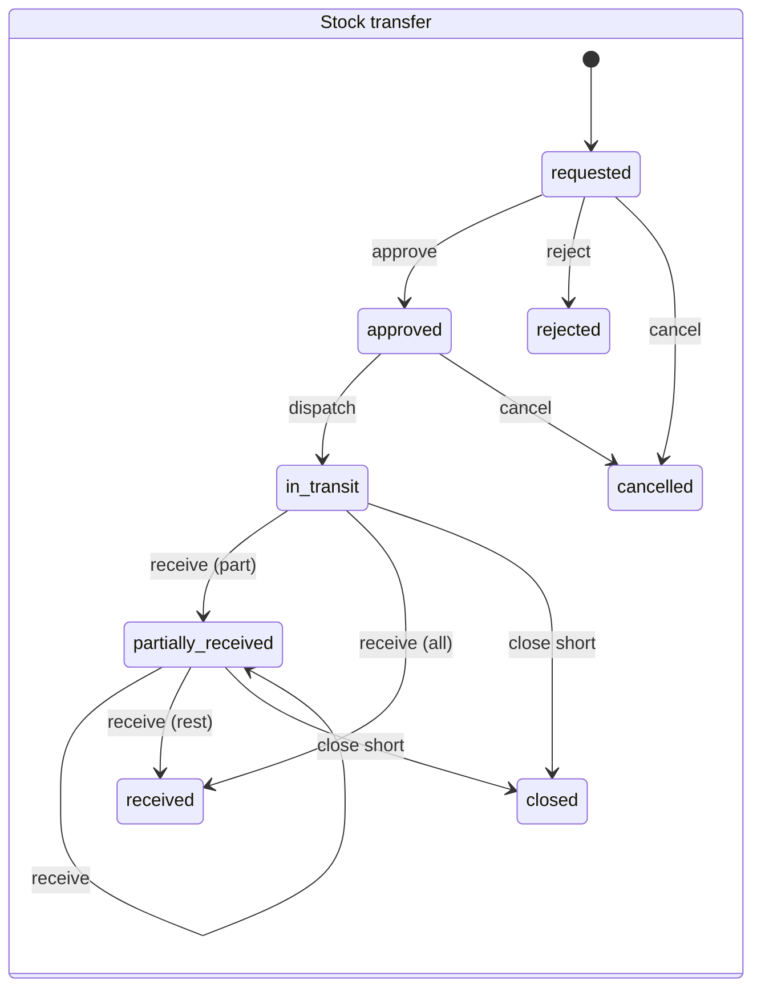

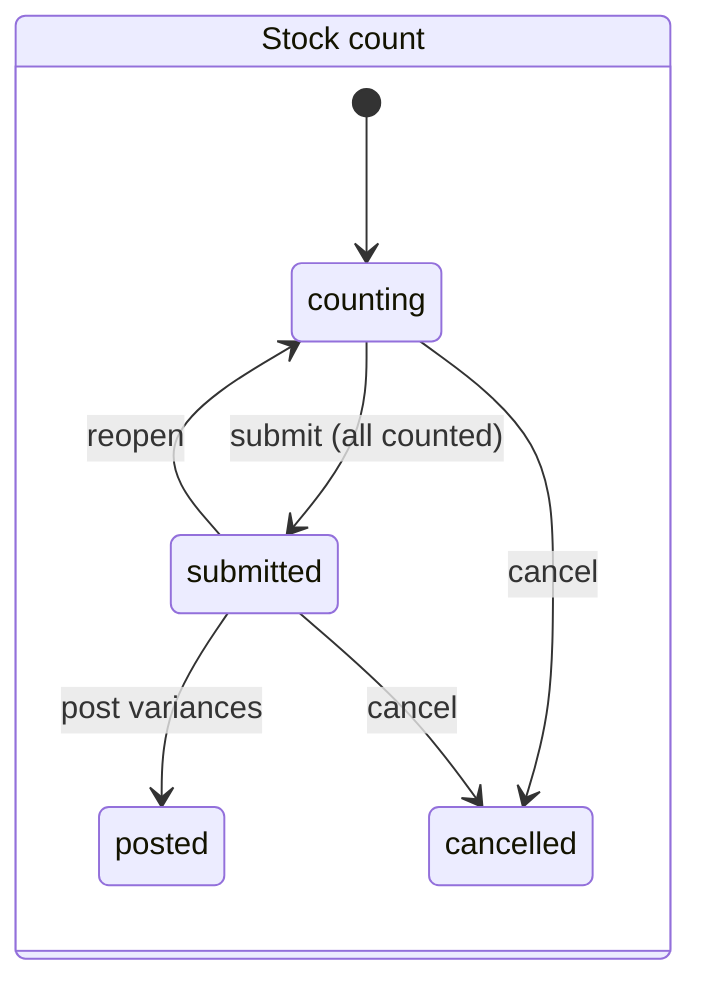

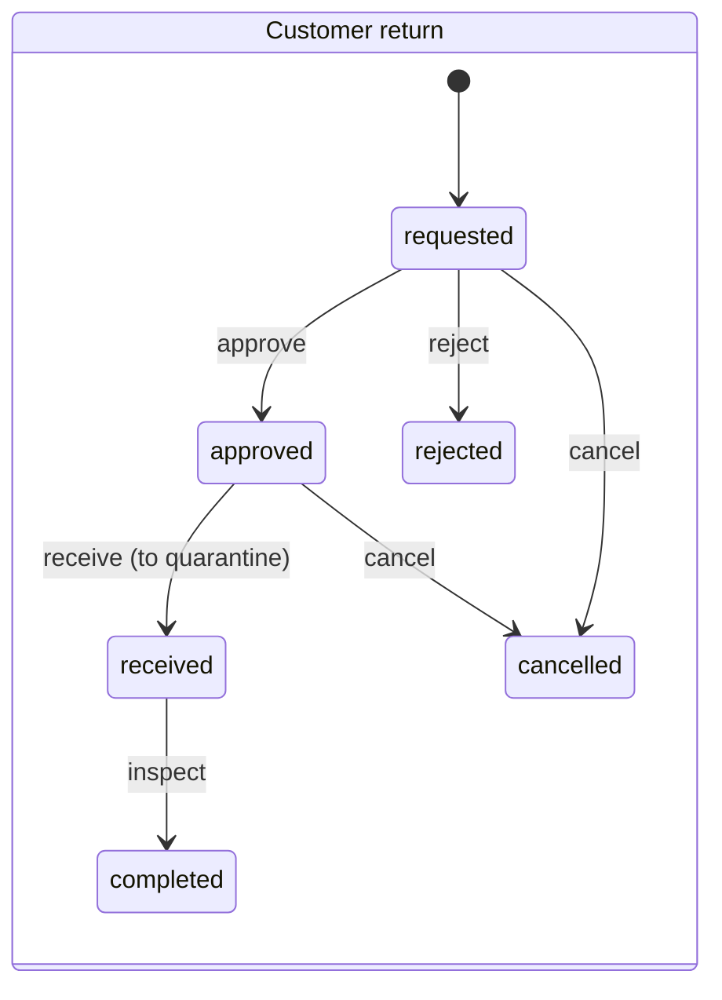

A transfer can't be cancelled once dispatched; what arrives is received and the rest is closed short. A posted count can't be cancelled; its adjustment is reversed instead.

### 2.6 Goods receipt posting (transaction)

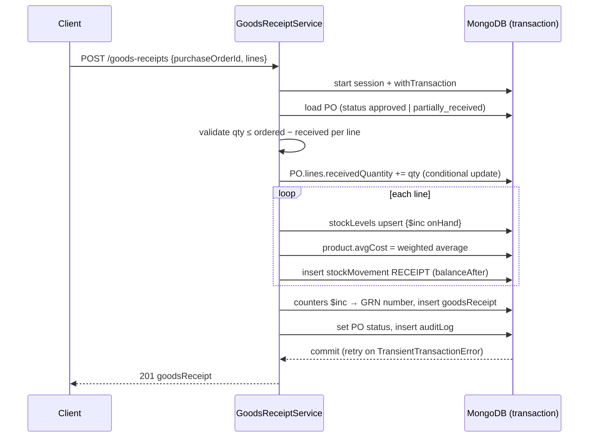

Every stock-changing operation follows this pattern: shipments, adjustments, transfer dispatch and receive, sales order confirmation and cancellation.

---

## 3. Data model

### 3.1 Conventions

- **Money** (prices, costs, order totals) is stored as integers in minor units (cents). `1999` means 19.99. Floating-point money is never stored.
- **Tax rates** are stored as integer basis points. `1800` means 18.00%. Tax is calculated so order totals are correct; StockFlow does not keep tax records.
- **Quantities** are integers in the product's base unit. A product sold by weight uses `g` as its unit, not `kg`.
- **Line items** are embedded in their parent document. They are bounded in size and always read with the parent, and updating them in one document keeps the update atomic.
- **Snapshots:** documents copy the party name, product SKU and product name at creation. Historical documents stay correct after master data is renamed.
- **Soft deactivation:** master data (products, warehouses, suppliers, customers, users) is deactivated with `isActive: false`, never deleted, once documents reference it. Draft documents can be hard-deleted.
- **Timestamps:** every collection has `createdAt` and `updatedAt` in UTC. Documents also record `createdBy`.
- **Optimistic concurrency:** Mongoose `optimisticConcurrency: true` is set on order and transfer documents. Status changes use conditional updates such as `findOneAndUpdate({ _id, status: 'approved' }, …)`.

### 3.2 Entity relationship diagram

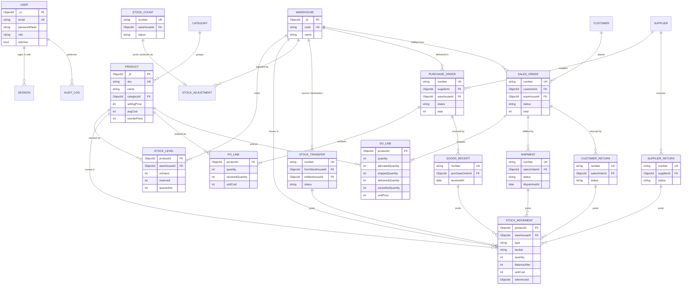

`STOCK_ADJUSTMENT` and `STOCK_TRANSFER` also write `STOCK_MOVEMENT` records, linked through `reference.type` and `reference.id`. Those edges are left out of the diagram to keep it readable.

### 3.3 Collections

The type notation below is shorthand. `?` means optional, `Ref<X>` is an ObjectId pointing at collection X, and `money` is an integer in minor units.

#### Identity and workspace

```ts
users {
  name: string
  email: string               // lowercased, trimmed
  passwordHash: string        // bcrypt, cost 12
  role: 'admin' | 'inventory_manager' | 'procurement_manager' | 'sales_manager' | 'staff'
  isActive: boolean
  mustChangePassword: boolean // true after admin creates or resets the account
  lastLoginAt?: Date
}
// indexes: { email: 1 } unique

sessions {                    // refresh tokens
  userId: Ref<users>
  tokenHash: string           // SHA-256 of the opaque refresh token
  familyId: string            // rotation chain; reuse of a rotated token revokes the family
  expiresAt: Date
  revokedAt?: Date
  replacedBy?: Ref<sessions>
  userAgent?: string; ip?: string
}
// indexes: { tokenHash: 1 } unique, { userId: 1 }, { familyId: 1 },
//          { expiresAt: 1 } TTL (expireAfterSeconds: 0)

settings {                    // single document, _id: 'workspace'
  companyName: string; address?: string; email?: string; phone?: string
  currency: string            // ISO 4217, e.g. 'USD'
  defaultTaxRate: number      // basis points
  numberPrefixes: { purchaseOrder: 'PO', goodsReceipt: 'GRN', salesOrder: 'SO',
                    shipment: 'SHP', adjustment: 'ADJ', transfer: 'TRF' }
}

counters {                    // gap-free document numbering inside the posting transaction
  _id: string                 // e.g. 'PO-2026'
  seq: number
}
// produces numbers like PO-2026-00042

auditLogs {
  at: Date
  actor?: { _id: Ref<users>; name: string; role: Role; email: string }   // email only for failed sign-ins
  method: 'POST' | 'PATCH' | 'PUT' | 'DELETE'
  action: string              // route pattern, e.g. '/purchase-orders/:id/approve'
  path: string                // the request path
  entityType: string          // first path segment, e.g. 'purchase-orders'
  entityId?: string           // :id, or the id of the created record
  status: number              // HTTP status (sign-in failures are recorded too)
  ip: string; requestId: string
}
// written after the response by the auditTrail() middleware: successful mutations and every sign-in attempt
// (not refresh, logout or notification reads)
// indexes: { at: -1 }, { 'actor._id': 1, at: -1 }, { entityType: 1, at: -1 }, { entityId: 1, at: -1 }
```

#### Master data

```ts
warehouses {
  code: string                // short unique code, uppercase
  name: string; address?: string
  isActive: boolean
}
// indexes: { code: 1 } unique

categories {
  name: string                // unique, case-insensitive
  code: string                // 2–6 chars, unique; prefixes generated SKUs
  description: string
}
// indexes: { name: 1 } unique (collation strength 2), { code: 1 } unique
// delete only when no product references the category

products {
  sku: string                 // uppercase, unique, immutable after creation
  name: string; description: string
  categoryId: Ref<categories> // required
  unit: 'pcs' | 'box' | 'pack' | 'pair' | 'set' | 'roll' | 'bottle' | 'bag' | 'm' | 'g' | 'ml'
  barcode: string             // '' when none
  costPrice: money            // default purchase price and opening-stock cost
  sellingPrice: money         // default price for new SOs
  taxRate: number             // basis points
  avgCost: money              // moving weighted average, maintained by costed stock-in
  reorderPoint: number        // default low-stock threshold per warehouse; 0 = off
  reorderQuantity: number     // suggested restock quantity
  isActive: boolean
}
// indexes: { sku: 1 } unique, { barcode: 1 } unique partial (barcode > ''),
//          { categoryId: 1 }, { isActive: 1, name: 1 }
// SKU generation: blank SKU → `${category.code}-${seq:05}` from counter `sku:${code}`,
// skipping numbers already taken by manually entered SKUs.

suppliers / customers {       // same shape, separate collections
  code: string                // unique, immutable; blank → generated SUP-0001 / CUS-0001
  name: string
  contactName: string; email: string; phone: string
  address: string; notes: string
  leadTimeDays: number | null // suppliers only: default delivery offset for new POs
  shippingAddress: string     // customers only
  isActive: boolean
  emailIndex: string | null   // customers only: blind index of the email (HMAC), for exact search
  erasedAt: Date | null; erasedBy: UserSnapshot | null; erasureReason: string  // customers only
}
// indexes: { code: 1 } unique, { isActive: 1, name: 1 }, customers { emailIndex: 1 }
// customers: contactName, email, phone, address, shippingAddress and notes are stored
// encrypted with the customer's data key (section 5.4); name and code stay in plaintext.

customerKeys {                // one per customer; _id = the customer's _id
  kekId: string | null        // master key that wraps the data key; null once shredded
  wrappedKey: string | null   // the customer's 32-byte data key, AES-256-GCM-wrapped
  shreddedAt: Date | null; shreddedBy: UserSnapshot | null; shredReason: string
}
```

#### Inventory

```ts
stockLevels {
  productId: Ref<products>
  warehouseId: Ref<warehouses>
  onHand: number              // usable units in the warehouse
  reserved: number            // committed to confirmed sales orders
  quarantine: number          // isolated units: never part of onHand or available
  reorderPoint: number | null // per-warehouse threshold override; null = product default
}
// indexes: { productId: 1, warehouseId: 1 } unique, { warehouseId: 1 }
// onHand ≥ 0, quarantine ≥ 0 and reserved ≤ onHand are enforced by conditional updates in
// stock.service.ts, the only code that writes them. Threshold edits are configuration.

stockMovements {              // append-only ledger, never updated or deleted
  productId: Ref<products>; warehouseId: Ref<warehouses>
  type: 'OPENING' | 'ADJUSTMENT' | 'RECEIPT' | 'SHIPMENT' | 'TRANSFER_OUT' | 'TRANSFER_IN'
      | 'CUSTOMER_RETURN' | 'SUPPLIER_RETURN' | 'QUARANTINE' | 'RELEASE' | 'WRITE_OFF'
  bucket: 'usable' | 'quarantine'   // which balance moved
  quantity: number            // signed: + into the bucket, − out
  balanceAfter: number        // that bucket's balance after this movement
  unitCost: money
  reference: { type: 'opening' | 'adjustment' | 'goodsReceipt' | 'shipment' | 'transfer'
                     | 'customerReturn' | 'supplierReturn', id: ObjectId, number: string }
  createdBy: Ref<users>; createdAt: Date
}
// Moving between buckets writes two movements (QUARANTINE or RELEASE), one per bucket.

stockAdjustments {            // opening stock, adjustments and quarantine documents
  number: string              // OPN-, ADJ- or QTN-2026-00001
  type: 'opening' | 'adjustment' | 'quarantine' | 'release' | 'write_off'
  warehouseId: Ref<warehouses>
  reason: 'count' | 'damage' | 'loss' | 'found' | 'correction' | 'other' | null
  notes: string
  lines: [{ productId, sku, name, unit, quantityChange, previousOnHand, balanceAfter,
            previousQuarantine?, quarantineAfter?, unitCost,
            reason? }]          // per-line reason for count postings
  reversalOf?: { _id, number }; reversedBy?: { _id, number }
  source?: { type: 'stockCount' | 'transfer', _id, number }
  createdBy; createdAt
}
// Quantities never change after posting; reversedBy is set once, atomically, by a reversal.

stockTransfers {
  number: string              // TRF-2026-00001
  status: 'requested' | 'approved' | 'in_transit' | 'partially_received' | 'received'
        | 'closed' | 'rejected' | 'cancelled'
  fromWarehouseId; toWarehouseId   // must differ
  neededBy?: Date; notes
  lines: [{ _id, productId, sku, name, unit, quantity,
            dispatchedQuantity, receivedQuantity, damagedQuantity, lostQuantity,
            unitCost? }]      // avgCost at dispatch
  carrier; reference
  requestedBy; approvedBy?; approvedAt?; dispatchedAt?; dispatchedBy?
  receipts: [{ at, by, note, lines: [{ lineId, receivedQuantity, damagedQuantity }] }]
  rejectionReason; cancelReason; closeReason; lossAdjustment?: { _id, number }
  history
}
// in transit per line = dispatched − received − damaged − lost
// indexes: { number: 1 } unique, { status: 1, createdAt: -1 }, { fromWarehouseId: 1, status: 1 },
//          { toWarehouseId: 1, status: 1 }, { 'lines.productId': 1, status: 1 }

stockCounts {
  number: string              // CNT-2026-00001
  status: 'counting' | 'submitted' | 'posted' | 'cancelled'
  isOpen: boolean             // counting or submitted
  warehouseId; category?: { _id, name }; notes
  lines: [{ _id, productId, sku, name, unit, snapshotQuantity, countedQuantity?,
            systemQuantity?, variance?, reason?, note }]   // system/variance set at posting
  adjustment?: { _id, number }
  createdBy; submittedBy?; postedBy?; postedAt?; history
}
// indexes: { number: 1 } unique, { warehouseId: 1 } unique where isOpen = true
```

#### Returns

```ts
customerReturns {
  number: string              // RMA-2026-00001
  status: 'requested' | 'approved' | 'received' | 'completed' | 'rejected' | 'cancelled'
  salesOrder: { _id, number }; customer: { _id, code, name }; warehouseId
  reason: 'damaged' | 'defective' | 'wrong_item' | 'not_needed' | 'other'; notes
  lines: [{ _id, soLineId, productId, sku, name, unit, quantity,
            receivedQuantity, restockedQuantity, quarantinedQuantity, note,
            unitCost }]       // cost the units shipped at
  requestedBy; approvedBy?; receivedAt?/By?; inspectedAt?/By?
  rejectionReason; cancelReason; history
}
// salesOrders.lines.returnedQuantity = Σ active returns' units (requested, or received once back)

supplierReturns {
  number: string              // SRN-2026-00001
  status: 'requested' | 'approved' | 'dispatched' | 'rejected' | 'cancelled'
  supplier: { _id, code, name }; warehouseId; purchaseOrder?: { _id, number }
  reason; notes
  lines: [{ _id, productId, sku, name, unit, quantity, source: 'usable' | 'quarantine', unitCost }]
  carrier; reference; requestedBy; approvedBy?; dispatchedAt?/By?
  rejectionReason; cancelReason; history
}
```

#### Procurement

```ts
supplierPrices {              // supplier price list
  supplierId: Ref<suppliers>; productId: Ref<products>
  unitCost: money; supplierSku: string
}
// indexes: { supplierId: 1, productId: 1 } unique, { productId: 1 }

purchaseRequests {
  number: string              // PR-2026-00001
  status: 'draft' | 'submitted' | 'approved' | 'rejected' | 'ordered' | 'cancelled'
  warehouseId: Ref<warehouses>
  supplier: { _id, code, name } | null      // preferred, optional
  neededBy: Date | null; notes: string
  lines: [{ _id, productId, sku, name, unit, quantity, note }]
  requestedBy: { _id, name }
  purchaseOrder: { _id, number } | null     // set when ordered
  rejectionReason: string
  history: [{ action, at, by: { _id, name }, note }]
}
// indexes: { number: 1 } unique, { status: 1, createdAt: -1 }, { 'requestedBy._id': 1, createdAt: -1 }

purchaseOrders {
  number: string              // PO-2026-00001
  status: 'draft' | 'pending_approval' | 'approved' | 'partially_received' | 'received' | 'closed' | 'cancelled'
  supplier: { _id, code, name }             // snapshot
  warehouseId: Ref<warehouses>              // destination
  purchaseRequest: { _id, number } | null
  orderDate: Date; expectedDate: Date | null
  lines: [{
    _id: ObjectId
    productId; sku; name; unit
    quantity: number                        // > 0
    receivedQuantity: number                // accepted into stock, ≤ quantity
    rejectedQuantity: number                // delivered but not accepted
    damagedQuantity: number
    unitCost: money; taxRate: number
    lineSubtotal: money; lineTax: money; lineTotal: money
  }]
  subtotal: money; taxTotal: money; total: money
  notes: string
  createdBy: { _id, name }; approvedBy: { _id, name } | null; approvedAt: Date | null
  rejectionReason: string; cancelReason: string; closeReason: string
  receiptCount: number
  history: [{ action, at, by: { _id, name }, note }]
}
// pending = quantity − receivedQuantity, or 0 when closed/cancelled
// indexes: { number: 1 } unique, { status: 1, orderDate: -1 }, { 'supplier._id': 1, orderDate: -1 },
//          { warehouseId: 1, status: 1 }, { 'lines.productId': 1, status: 1 }

goodsReceipts {
  number: string              // GRN-2026-00001
  purchaseOrder: { _id, number }
  supplier: { _id, code, name }; warehouseId
  receivedAt: Date; expectedDate: Date | null   // copied from the PO for on-time reporting
  deliveryNote: string; notes: string
  lines: [{ poLineId, productId, sku, name, unit,
            acceptedQuantity, rejectedQuantity, damagedQuantity, rejectionReason, unitCost }]
  createdBy: { _id, name }
}
// posted at creation; immutable. accepted ≤ outstanding per line; a reason is required for rejected/damaged.
// indexes: { number: 1 } unique, { 'purchaseOrder._id': 1 }, { 'supplier._id': 1, receivedAt: -1 }, { receivedAt: -1 }
```

#### Order fulfilment

```ts
salesOrders {
  number: string                        // SO-2026-00001
  status: 'draft' | 'confirmed' | 'partially_shipped' | 'shipped' | 'delivered' | 'cancelled'
  customer: { _id, code, name }         // snapshot
  warehouseId: Ref<warehouses>          // fulfilling warehouse
  orderDate: Date; requiredDate?: Date
  shippingAddress: string               // defaults to the customer's shipping address
  customerReference: string; notes: string
  lines: [{
    _id; productId; sku; name; unit
    quantity: number
    allocatedQuantity: number           // on pick lists not yet dispatched
    shippedQuantity: number             // dispatched
    deliveredQuantity: number           // on delivered shipments
    cancelledQuantity: number           // released without shipping
    unitPrice: money; discountRate: number /* basis points */; taxRate: number
    lineGross; lineDiscount; lineSubtotal; lineTax; lineTotal
  }]
  grossTotal; discountTotal; subtotal; taxTotal; total
  createdBy; confirmedBy?; confirmedAt?; cancelReason
  shipmentCount: number
  history: [{ action, at, by: { _id, name }, note }]
}
// per line: quantity ≥ allocated + shipped + cancelled; reserved = quantity − shipped − cancelled
// indexes: { number: 1 } unique, { status: 1, orderDate: -1 }, { 'customer._id': 1, orderDate: -1 },
//          { warehouseId: 1, status: 1 }, { 'lines.productId': 1, status: 1 }

shipments {
  number: string                        // SHP-2026-00001
  status: 'picking' | 'picked' | 'packed' | 'dispatched' | 'in_transit' | 'delivered' | 'cancelled'
  salesOrder: { _id, number }; customer: { _id, code, name }; warehouseId
  shippingAddress: string
  lines: [{ _id, soLineId, productId, sku, name, unit,
            quantity,                   // requested on the pick list
            pickedQuantity?,            // set at picking; what's packed and dispatched
            unitCost? }]                // average cost at dispatch
  notes; shortPickReason; packageCount?; weightGrams?
  carrier; trackingNumber; receivedBy; cancelReason
  pickedAt?/By?; packedAt?/By?; dispatchedAt?/By?; deliveredAt?
  tracking: [{ type: 'dispatched' | 'in_transit' | 'out_for_delivery' | 'delivery_attempted' | 'delivered',
               at, location, note, by }]
  history: [{ action, at, by, note }]
  createdBy
}
// indexes: { number: 1 } unique, { 'salesOrder._id': 1 }, { status: 1, createdAt: -1 },
//          { warehouseId: 1, status: 1 }, { 'customer._id': 1, createdAt: -1 }, { dispatchedAt: -1 }
```

---

## 4. Inventory calculations and consistency rules

### 4.1 Quantities

| Figure            | Definition                                                                                                                        | Stored or derived       |
| ----------------- | --------------------------------------------------------------------------------------------------------------------------------- | ----------------------- |
| `onHand`          | Units physically in a warehouse                                                                                                   | Stored on `stockLevels` |
| `reserved`        | Σ `(quantity − shipped − cancelled)` over lines of open sales orders; picked and packed units stay reserved until dispatch        | Stored on `stockLevels` |
| `available`       | `onHand − reserved`                                                                                                               | Derived                 |
| `incoming`        | Σ `(quantity − receivedQuantity)` over lines of POs in `approved` or `partially_received` for that warehouse                      | Derived (aggregation)   |
| `inTransit`       | Σ `(dispatched − received − damaged − lost)` over lines of transfers in transit                                                   | Derived                 | \n  | `quarantine` | Isolated units: returns awaiting inspection, damaged goods. Never part of `onHand` or `available` | Stored on `stockLevels` |
| Low stock         | `available ≤ (level.reorderPoint ?? product.reorderPoint)` in an active warehouse that holds the product, when that threshold > 0 | Derived                 |
| Suggested reorder | `max(reorderQuantity, reorderPoint − available − incoming)`                                                                       | Derived                 |

### 4.2 Costing: moving weighted average

`product.avgCost` is one value per product, shared by all warehouses. It is recalculated on every goods receipt line:

```
Q   = total onHand of the product across all warehouses, before the receipt
q   = received quantity,  c = PO line unit cost
avgCost' = Q ≤ 0 ? c : round((Q × avgCost + q × c) / (Q + q))
```

- Shipments, negative adjustments and transfer dispatches record `unitCost = avgCost` at that moment. For shipments this gives the cost of goods shipped.
- Transfers and adjustments do not change `avgCost`.
- Inventory valuation is Σ `onHand × avgCost`, plus in-transit transfer value at the cost recorded on dispatch.
- Rounding is half-up to the nearest minor unit. The helpers live in `packages/shared/money.ts`.

### 4.3 Order totals

For each line:

```
lineGross    = quantity × unitPrice                            // purchases: quantity × unitCost
lineDiscount = round(lineGross × discountRate / 10000)         // sales only
lineSubtotal = lineGross − lineDiscount
lineTax      = round(lineSubtotal × taxRate / 10000)
lineTotal    = lineSubtotal + lineTax
```

Document totals (`grossTotal`, `discountTotal`, `subtotal`, `taxTotal`, `total`) are sums of the line values. Tax is rounded per line. The frontend uses the same shared function for previews, but the server always recalculates and ignores totals sent by the client.

### 4.4 Invariants

These must hold at all times. Integration tests assert them.

1. `stockLevels.onHand ≥ 0` and `0 ≤ reserved ≤ onHand`.
2. `onHand` for a (product, warehouse) equals Σ `stockMovements.quantity` for that pair (ledger reconciliation).
3. PO line: `0 ≤ receivedQuantity ≤ quantity`.
4. SO line: `allocated + shipped + cancelled ≤ quantity` and `delivered ≤ shipped`. `allocated` equals the picked (or requested) units on the line's undispatched shipments; `shipped` equals the picked units on its dispatched shipments.
5. Σ `reserved` per (product, warehouse) equals Σ `(quantity − shipped − cancelled)` over lines of confirmed sales orders for that warehouse, and Σ `SHIPMENT` movements equals −Σ units dispatched.
6. Every posted receipt, shipment, adjustment and transfer has matching movement records whose quantities sum to the document's lines.
7. Posted stock documents (receipts, shipments, adjustments, dispatched transfers, received returns) are never edited or deleted. Mistakes are corrected with a reversal or a new adjustment.
8. Each bucket's balance equals the sum of its movements: `onHand` for `usable`, `quarantine` for `quarantine`.
9. Transfer line: `received + damaged + lost ≤ dispatched ≤ quantity`; Σ `TRANSFER_OUT` equals −Σ dispatched and Σ `TRANSFER_IN` equals Σ (received + damaged + lost).
10. Order line `returnedQuantity ≤ shipped` and equals the units on its active returns; each return's `CUSTOMER_RETURN` movements equal what it received, and once inspected `restocked + quarantined = received`.

### 4.5 How consistency is enforced

| Operation         | Stock effect                                                                   | Guard                                                                                                                                                                                            |
| ----------------- | ------------------------------------------------------------------------------ | ------------------------------------------------------------------------------------------------------------------------------------------------------------------------------------------------ |
| SO confirm        | `reserved += q`                                                                | `updateOne({productId, warehouseId, $expr: {$gte: [{$subtract: ['$onHand','$reserved']}, q]}}, {$inc: {reserved: q}})`. If no document matches, the transaction aborts with `INSUFFICIENT_STOCK` |
| SO cancel         | `reserved −= (quantity − shipped − cancelled)`                                 | Status condition on the SO; open pick lists are cancelled in the same transaction                                                                                                                |
| Pick list         | none (allocates on the SO line)                                                | `q ≤ quantity − allocated − shipped − cancelled`, checked in the transaction that updates the SO                                                                                                 |
| Dispatch          | `onHand −= q`, `reserved −= q`                                                 | Shipment status `packed`; `updateOne({…, onHand: {$gte: q}, reserved: {$gte: q}}, {$inc: {onHand: −q, reserved: −q}})`                                                                           |
| Goods receipt     | `onHand += q` (upsert)                                                         | `q ≤ quantity − receivedQuantity` (conditional update on the PO line)                                                                                                                            |
| Adjustment        | `onHand += delta`                                                              | For negative deltas: `onHand + delta ≥ reserved`                                                                                                                                                 |
| Transfer dispatch | source `onHand −= q`                                                           | Status `approved`; `onHand − reserved ≥ q`                                                                                                                                                       |
| Transfer receive  | destination `onHand` (good) or `quarantine` (damaged) `+= q`                   | Status in transit; `q ≤ in transit` per line, checked in the transaction that updates the transfer                                                                                               |
| Count posting     | `onHand += counted − onHand`                                                   | Status `submitted`; variance read inside the transaction; counted ≥ reserved                                                                                                                     |
| Quarantine move   | `onHand −= q`, `quarantine += q` (or the reverse); write-off `quarantine −= q` | Moving in: `onHand − reserved ≥ q`; moving out: `quarantine ≥ q`                                                                                                                                 |
| Customer return   | receive: `quarantine += q`; inspect: `quarantine −= r`, `onHand += r`          | `q ≤ shipped − returnedQuantity` (order line, same transaction)                                                                                                                                  |
| Supplier return   | source bucket `−= q`                                                           | Status `approved`; usable: `onHand − reserved ≥ q`; quarantine: `quarantine ≥ q`                                                                                                                 |
| Reversal          | `onHand −= original change`                                                    | Original not already reversed (`reversedBy: null` in the update filter)                                                                                                                          |

- Every row above runs inside `session.withTransaction()`. The stock level update, ledger insert, parent document update, document number and audit entry commit together or not at all. The driver retries the transaction on write conflicts.
- The guards are conditional updates on the server, not read-then-write checks. When two requests race for the last units, exactly one succeeds. A concurrency test covers this.
- Status changes check the expected current status in the update filter. A double submit therefore cannot apply twice.
- Stock-posting `POST` endpoints accept an optional `Idempotency-Key` header. It is stored with a unique partial index, so a retried request returns the original document instead of posting again.
- MongoDB transactions need a replica set. Development, CI and Docker run a single-node replica set, and tests use `mongodb-memory-server` in replica-set mode.

---

## 5. Authentication and authorisation

### 5.1 Tokens

| Token   | Format                                          | Lifetime   | Storage on client                                                   | Transport               |
| ------- | ----------------------------------------------- | ---------- | ------------------------------------------------------------------- | ----------------------- |
| Access  | JWT (HS256), claims `sub`, `role`, `iat`, `exp` | 15 minutes | Memory only (auth context)                                          | `Authorization: Bearer` |
| Refresh | 256-bit random, opaque                          | 7 days     | `httpOnly`, `Secure`, `SameSite=Strict` cookie, `Path=/api/v1/auth` | Cookie                  |

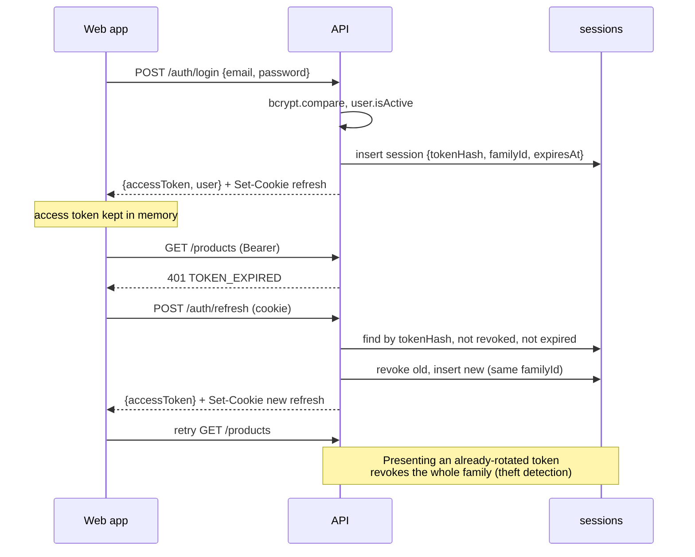

- On page load the app calls `/auth/refresh` to restore the session. Concurrent 401 responses share a single in-flight refresh promise.
- Logout revokes the session and clears the cookie. When an admin resets a password or deactivates a user, all of that user's sessions are revoked.
- The `authenticate` middleware verifies the JWT and then loads the user from the database on every request (a small indexed `_id` lookup). Deactivating a user or changing a role takes effect immediately, without waiting for the access token to expire.

### 5.2 Account security

- bcrypt with cost 12. Minimum password length 10, maximum 128.
- There is no public signup. The first admin comes from the seed script or the `BOOTSTRAP_ADMIN_*` environment variables when the users collection is empty. Admins create every other user with a temporary password and `mustChangePassword: true`. Until the password is changed, the API allows only `/auth/me`, `/auth/change-password` and `/auth/logout`.
- `/auth/login` is rate-limited per IP and per email (`express-rate-limit`). Login errors are generic, so they don't reveal whether an email exists.
- `helmet`, a CORS allowlist from config, a JSON body limit and `trust proxy` configured for the reverse proxy.
- CSRF: the API authenticates through the bearer header, which cross-site requests cannot attach. The only cookie is path-scoped to the auth routes and set `SameSite=Strict`.

### 5.3 Permissions

Permissions are string constants in `packages/shared/permissions.ts`, together with the role → permission map. The server enforces them with `authorize(permission)` middleware. The client uses the same map only to hide navigation and actions.

| Permission                 | Admin | Inventory Mgr | Procurement Mgr | Sales Mgr | Staff |
| -------------------------- | :---: | :-----------: | :-------------: | :-------: | :---: |
| `users:manage`             |   ✓   |               |                 |           |       |
| `settings:manage`          |   ✓   |               |                 |           |       |
| `audit:read`               |   ✓   |               |                 |           |       |
| `warehouses:manage`        |   ✓   |       ✓       |                 |           |       |
| `categories:manage`        |   ✓   |       ✓       |                 |           |       |
| `products:write`           |   ✓   |       ✓       |                 |           |       |
| `stock:adjust`             |   ✓   |       ✓       |                 |           |       |
| `stock:transfer`           |   ✓   |       ✓       |                 |           |   ✓   | \n  | `transfers:approve`     | ✓   | ✓   |     |     |     | \n  | `stock:count`           | ✓   | ✓   |     |     | ✓   |
| `goodsReceipts:create`     |   ✓   |       ✓       |                 |           |   ✓   |
| `shipments:create`         |   ✓   |       ✓       |                 |           |   ✓   |
| `suppliers:write`          |   ✓   |               |        ✓        |           |       |
| `purchaseRequests:create`  |   ✓   |       ✓       |        ✓        |           |   ✓   |
| `purchaseRequests:approve` |   ✓   |               |        ✓        |           |       |
| `purchaseOrders:write`     |   ✓   |               |        ✓        |           |       |
| `purchaseOrders:approve`   |   ✓   |               |        ✓        |           |       |
| `customers:write`          |   ✓   |               |                 |     ✓     |       |
| `customers:erase`          |   ✓   |               |                 |           |       |
| `salesOrders:write`        |   ✓   |               |                 |     ✓     |       | \n  | `customerReturns:write` | ✓   |     |     | ✓   |     | \n  | `supplierReturns:write` | ✓   | ✓   | ✓   |     |     | \n  | `supplierReturns:approve` | ✓   |     | ✓   |     |     | \n  | `returns:process` | ✓   | ✓   |     |     | ✓   |
| `reports:inventory`        |   ✓   |       ✓       |                 |           |       |
| `reports:purchasing`       |   ✓   |               |        ✓        |           |       |
| `reports:fulfilment`       |   ✓   |               |                 |     ✓     |       |

- **Read access:** any signed-in user can read master data, stock, purchase orders and sales orders. Reports need the matching `reports:*` permission, because inventory valuation exposes cost figures.
- **Separation of duties:** a purchase order cannot be approved by the user who created it, unless that user is an admin. A procurement manager's own POs need approval from another procurement manager or an admin.

### 5.4 Customer personal data: encryption and erasure

Customer contact details are personal data. They are encrypted at rest so that a customer can be erased on request without deleting or rewriting any business record (crypto-shredding).

- **Envelope encryption.** Each customer gets a random 256-bit data key (DEK) when created. It is stored only in `customerKeys`, wrapped with AES-256-GCM by a master key (KEK) from `DATA_ENCRYPTION_KEYS`, a comma-separated list of `id:base64key` entries. The first entry wraps new keys; the others stay readable for rotation. Master keys live only in the environment, never in the database.
- **Encrypted fields.** On the customer: `contactName`, `email`, `phone`, `address`, `shippingAddress`, `notes`. The delivery address copied onto sales orders and shipments is sealed with the same customer's key; a shipment copies the order's ciphertext unchanged. The customer's `name` and `code` stay in plaintext: they identify the business on documents, reports and notifications, and history must keep reading after an erasure.
- **Format.** `enc:v1:` + base64url(12-byte IV ‖ ciphertext ‖ 16-byte tag), AES-256-GCM. The additional authenticated data is `<customerId>:<field>` (`<customerId>:document.shippingAddress` on orders and shipments), so a value can't be moved to another field or customer without failing authentication. Empty strings stay empty. Plaintext found where ciphertext is expected is an error, not a fallback.
- **Search.** Ciphertext can't be searched, so customers have `emailIndex`: an HMAC-SHA256 of the normalised email under `BLIND_INDEX_KEY`. Search matches name and code as before, and the email only when it is typed in full. Contact name and phone are not searchable.
- **Reading.** The API decrypts when building DTOs, loading all keys for a page in one query. Keys are not cached, so an erasure takes effect on the next request on every instance.
- **Erasure** (`POST /customers/:id/erase`, `customers:erase`, admin only) takes a reason and the customer's code typed as confirmation. It is refused with 409 while the customer has open sales orders, undelivered shipments or open returns, since those still need the address. In one transaction, it:
  1. blanks the delivery address on the customer's draft orders,
  2. shreds the key: `wrappedKey` and `kekId` set to null, conditional on `shreddedAt: null`, so of two concurrent erasures exactly one succeeds,
  3. blanks the personal fields and `emailIndex`, deactivates the customer and records `erasedAt`, `erasedBy` and `erasureReason`.

  Afterwards the customer can't be edited (409), a draft for them can't be confirmed and new orders can't be created (400 on `customerId`). Orders, shipments, returns, the stock ledger, reports and the audit log are untouched; their DTOs carry `customerErased: true` and an empty address.

- **Backups.** A backup taken before the erasure still holds the wrapped key, so the data can be recovered from it while the master key exists. Keep backup retention for the database within the erasure deadline you commit to, or back up `customerKeys` separately with a shorter retention.
- **Rotating the master key.** Put a new key first in `DATA_ENCRYPTION_KEYS`, keep the old one after it, restart the API, then run `npm run privacy:rotate-key -w @stockflow/api`. It re-wraps each live data key with a conditional update (the data itself is never re-encrypted) and exits non-zero while any key remains under an old master key. Then remove the old key.
- **Existing data.** `npm run privacy:encrypt-existing -w @stockflow/api` encrypts records written before encryption existed: it creates missing keys, seals plaintext customer fields with their blind index, and seals plaintext addresses on orders and shipments. Each record is rewritten conditional on the value it read, so it is safe to rerun or to run while the API is serving.
- **Losing a master key** makes every customer it wraps unreadable, exactly as if they were erased. Store the keys in a secret manager and back them up apart from the database.

---

## 6. Backend architecture and API

### 6.1 Layers

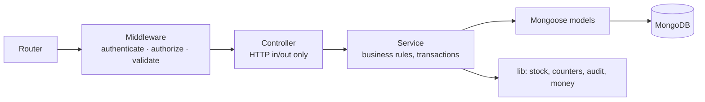

- **Feature modules:** each domain folder holds its model, routes and service. Route handlers act as the controllers.
- **Route handlers** parse the input with its Zod schema, call a service and shape the response. They contain no business logic.
- **Services** own the rules. They take a `ctx` (`{ user, session? }`) so they can be composed inside one transaction. For example, `goodsReceiptService.create` calls `stockService.applyMovement` with the same session.
- **`stockService`** is the only code that writes `stockLevels` or `stockMovements`.
- **Validation:** Zod schemas in `packages/shared` are parsed in route handlers (a `ZodError` becomes a 400 `VALIDATION_ERROR` with field details) and reused by the frontend forms.
- **Config:** `env.ts` parses `process.env` with Zod at startup. Missing or invalid configuration stops the process.

### 6.2 Conventions

- Base path `/api/v1`. JSON only.
- List endpoints: `?page=1&pageSize=25&sort=-createdAt&search=…&<filters>`. The response is `{ data: [...], meta: { page, pageSize, total } }`, with `pageSize ≤ 100`.
- Single resource: `{ data: {...} }`.
- Errors: `{ error: { code, message, details? } }`, with stable codes such as `VALIDATION_ERROR` (400, field details), `UNAUTHENTICATED` and `TOKEN_EXPIRED` (401), `FORBIDDEN` (403), `NOT_FOUND` (404), `CONFLICT`, `INVALID_STATE` and `INSUFFICIENT_STOCK` (409), and `RATE_LIMITED` (429). Unknown errors return 500 with a generic message and are logged with their stack.
- Actions are sub-resources: `POST /purchase-orders/:id/approve`. They are not done by `PATCH`ing the status.
- Logging: `pino` with `pino-http`. A request ID is generated or taken from `X-Request-Id`, returned in a header and included in every log line. Passwords, tokens and cookies are redacted.

### 6.3 Endpoints

| Area              | Endpoints                                                                                                                                                                                                                                                                                                                                                                                                                                                                                    | Permission                          |
| ----------------- | -------------------------------------------------------------------------------------------------------------------------------------------------------------------------------------------------------------------------------------------------------------------------------------------------------------------------------------------------------------------------------------------------------------------------------------------------------------------------------------------- | ----------------------------------- |
| Health            | `GET /health` (checks the DB ping)                                                                                                                                                                                                                                                                                                                                                                                                                                                           | public                              |
| Auth              | `POST /auth/login`, `POST /auth/refresh`, `POST /auth/logout`, `GET /auth/me`, `POST /auth/change-password`                                                                                                                                                                                                                                                                                                                                                                                  | public / authenticated              |
| Users             | `GET /users`, `POST /users`, `GET /users/:id`, `PATCH /users/:id` (name, role, isActive), `POST /users/:id/reset-password`                                                                                                                                                                                                                                                                                                                                                                   | `users:manage`                      |
| Settings          | `GET /settings`, `PATCH /settings`                                                                                                                                                                                                                                                                                                                                                                                                                                                           | read: any; write: `settings:manage` |
| Audit             | `GET /audit-logs?search&entityType&entityId&actorId&outcome=failed&from&to&page&pageSize`                                                                                                                                                                                                                                                                                                                                                                                                    | `audit:read`                        |
| Warehouses        | `GET`, `POST /warehouses`, `GET`, `PATCH /warehouses/:id`                                                                                                                                                                                                                                                                                                                                                                                                                                    | write: `warehouses:manage`          |
| Categories        | `GET`, `POST /categories`, `PATCH`, `DELETE /categories/:id` (only when unused)                                                                                                                                                                                                                                                                                                                                                                                                              | write: `categories:manage`          |
| Products          | `GET /products?search&categoryId&isActive&lowStock`, `POST`, `GET /products/:id` (with stock per warehouse), `PATCH /products/:id`                                                                                                                                                                                                                                                                                                                                                           | write: `products:write`             |
| Suppliers         | `GET`, `POST /suppliers`, `GET`, `PATCH /suppliers/:id`; `GET /suppliers/:id/prices`, `PUT`/`DELETE /suppliers/:id/prices/:productId`; `GET /suppliers/:id/delivery-summary`; `GET /products/:id/supplier-prices`                                                                                                                                                                                                                                                                            | write: `suppliers:write`            |
| Customers         | `GET`, `POST /customers`, `GET`, `PATCH /customers/:id` (detail includes open SOs), `POST /customers/:id/erase` (`customers:erase`)                                                                                                                                                                                                                                                                                                                                                          | write: `customers:write`            |
| Stock             | `GET /stock/levels?search&warehouseId&categoryId&productId&status(low\\                                                                                                                                                                                                                                                                                                                                                                                                                      | out\\                               | available)&sort`, `PATCH /stock/levels/:id`(threshold override,`products:write`), `GET /stock/movements?productId&warehouseId&type&direction(in\\ | out)&bucket&from&to`, `GET /stock/quarantine`, `POST /stock/quarantine` (`stock:adjust`) | read: any |
| Adjustments       | `GET /stock/adjustments?type&warehouseId`, `GET /stock/adjustments/:id`, `POST /stock/adjustments` (posts immediately), `POST /stock/adjustments/:id/reverse`, `POST /stock/opening`                                                                                                                                                                                                                                                                                                         | write: `stock:adjust`               |
| Counts            | `GET`, `POST /stock-counts` (`stock:count`), `GET /stock-counts/:id`, `PUT /:id/counts`, `POST /:id/submit`, `/reopen`, `/cancel` (`stock:count`), `POST /:id/post` (`stock:adjust`)                                                                                                                                                                                                                                                                                                         | see left                            |
| Returns           | `GET`, `POST /customer-returns`, `GET /:id`, `POST /:id/approve`, `/reject`, `/cancel` (`customerReturns:write`), `/receive`, `/inspect` (`returns:process`); `GET`, `POST /supplier-returns` (`supplierReturns:write`), `POST /:id/approve`, `/reject` (`supplierReturns:approve`), `/cancel`, `/dispatch` (`returns:process`)                                                                                                                                                              | see left                            |
| Ops summary       | `GET /warehouse-ops/summary`                                                                                                                                                                                                                                                                                                                                                                                                                                                                 | any                                 |
| Transfers         | `GET /stock-transfers?search&status&inTransit&warehouseId&productId`, `POST`, `GET`, `PATCH /stock-transfers/:id` (requested), `POST /:id/dispatch`, `/receive`, `/cancel` (`stock:transfer`); `POST /:id/approve`, `/reject`, `/close` (`transfers:approve`)                                                                                                                                                                                                                                | see left                            |
| Purchase orders   | `GET /purchase-orders?search&status&open&overdue&supplierId&warehouseId&productId&sort`, `POST`, `GET`, `PATCH`/`DELETE /purchase-orders/:id` (draft), `POST /purchase-orders/:id/submit`, `/cancel` (no receipts yet), `/close` (partially received)                                                                                                                                                                                                                                        | `purchaseOrders:write`              |
|                   | `POST /purchase-orders/:id/approve`, `/reject`                                                                                                                                                                                                                                                                                                                                                                                                                                               | `purchaseOrders:approve`            |
| Purchase requests | `GET /purchase-requests?search&status&warehouseId&mine`, `POST`, `GET`, `PATCH`/`DELETE /purchase-requests/:id` (draft, requester), `POST /:id/submit`, `/cancel`; `POST /:id/approve`, `/reject` (`purchaseRequests:approve`); `POST /:id/convert` (`purchaseOrders:write`)                                                                                                                                                                                                                 | write: `purchaseRequests:create`    |
| Goods receipts    | `GET /goods-receipts?search&purchaseOrderId&supplierId&warehouseId&issues&from&to`, `POST /goods-receipts`, `GET /goods-receipts/:id`                                                                                                                                                                                                                                                                                                                                                        | write: `goodsReceipts:create`       |
| Sales orders      | `GET /sales-orders?search&status&open&toFulfil&customerId&warehouseId&productId&sort`, `POST`, `GET`, `PATCH`/`DELETE /sales-orders/:id` (draft), `POST /sales-orders/:id/confirm`, `/cancel` (whole order or unshipped remainder); `GET /sales-orders/fulfilment-summary`                                                                                                                                                                                                                   | write: `salesOrders:write`          |
| Availability      | `GET /stock/availability?productIds=a,b` (on hand, reserved, available per warehouse)                                                                                                                                                                                                                                                                                                                                                                                                        | any                                 |
| Shipments         | `GET /shipments?search&status&pending&inTransit&salesOrderId&customerId&warehouseId&from&to`, `POST /shipments` (pick list), `GET /shipments/:id`, `POST /shipments/:id/pick`, `/pack`, `/dispatch`, `/tracking`, `/cancel`                                                                                                                                                                                                                                                                  | write: `shipments:create`           |
| Reports           | `GET /reports/overview` (any; values need `reports:inventory`); `/reports/inventory/movement-trend`, `/velocity`, `/warehouses`, `/availability`, `/categories` (`reports:inventory`); `/reports/purchasing/trend`, `/suppliers`, `/deliveries`, `/pending` (`reports:purchasing`); `/reports/sales/trend`, `/top-products`, `/fulfilment`, `/orders` (`reports:fulfilment`). All take `from`, `to` (default the last 30 days, at most 731) and filters; tables page and accept `format=csv` | see left                            |
| Notifications     | `GET /notifications?type&unread`, `GET /notifications/summary` (unread count and approvals waiting for the caller), `POST /notifications/:id/read`, `POST /notifications/read-all`                                                                                                                                                                                                                                                                                                           | own only                            |

Reports are MongoDB aggregations over the source documents. Nothing is pre-aggregated, which is fast enough at SMB data volumes given the indexes above. Product-level tables (velocity, availability, categories) combine per-product aggregations in memory before paging; CSV exports return up to 10,000 rows.

- **Trends** bucket by day (ranges up to 62 days), week (up to 366) or month, in UTC with weeks starting Monday; empty periods are zero. Series with different units are separate charts, never two axes.
- **Stock movement:** usable units in and out from the ledger. Without a warehouse filter, transfers count at both ends.
- **Fast and slow movers:** units shipped in the range as a daily rate; days of cover = on hand ÷ rate. Fast ≤ 30 days, slow > 90 days or stock with no shipments.
- **Availability:** per product: on hand, reserved, available, quarantined, still due on approved POs, and in transit.
- **Supplier performance:** deliveries in the range against each order's expected date (on time, late, average days late), and rejected or damaged units as a share of delivered units.
- **Top products:** units dispatched, revenue at each order line's net price (after discount, before tax), and cost at dispatch.
- **Fulfilment:** for orders created in the range: confirmed, completed, cancelled; hours from confirmation to first dispatch; days to delivery; on-time delivery against the required date.

**Notifications** are stored per user and created by the workflow that causes them, in the same transaction, so a rolled-back action leaves none behind. Recipients are chosen by permission (e.g. approvers) or by role in the document (requester, creator), excluding the person who acted and deactivated users. Low-stock alerts fire when available stock crosses the threshold downwards, from a withdrawal or a reservation, and go to inventory and procurement.

---

## 7. Frontend architecture

### 7.1 Structure

- **Routing:** React Router with a data-router layout. The `RequireAuth` route guard handles redirects to login and forced password changes. `RequirePermission` wraps admin pages and renders a 403 page.
- **Server state:** TanStack Query only, with no separate client store. Query keys are per feature (`['purchaseOrders', 'list', params]`). Mutations invalidate the related keys. Posting a receipt, for example, invalidates the PO, stock and product queries.
- **API client:** a thin `fetch` wrapper that attaches the bearer token, refreshes once on `TOKEN_EXPIRED`, and turns error responses into a typed `ApiError`.
- **Forms:** `react-hook-form` with `zodResolver`, using the shared schemas and shadcn `Form` components. Server `VALIDATION_ERROR` details are mapped back onto the fields.
- **Tables:** one `DataTable` component built on TanStack Table, with server-side pagination, sorting and filters kept in the URL search params so views can be linked and survive a reload.
- **Feedback:** toasts for completed actions, inline errors for failures, confirmation dialogs for irreversible actions (approve, post, dispatch, cancel), and skeleton rows while loading.
- **Money input and display:** the user types decimals and the app stores minor units. Display uses `Intl.NumberFormat` with the workspace currency.

### 7.2 Navigation

The sidebar is grouped. Items the user lacks permission for are hidden.

| Group      | Pages                                                                               |
| ---------- | ----------------------------------------------------------------------------------- |
| —          | Dashboard                                                                           |
| Inventory  | Products, Stock levels, Movements, Adjustments, Transfers, Stock counts, Quarantine | \n  | Returns | Customer returns, Supplier returns |
| Purchasing | Purchase orders, Goods receipts, Suppliers                                          |
| Sales      | Sales orders, Shipments, Customers                                                  |
| —          | Dashboard, Analytics, Notifications                                                 |
| Admin      | Users, Warehouses, Categories, Settings, Audit log                                  |

The top bar has a global warehouse filter that defaults to "All warehouses" and is applied to stock views. It also has the user menu: profile, change password and sign out.

### 7.3 Pages

| Page                   | Contents                                                                                                                                                                                                  |
| ---------------------- | --------------------------------------------------------------------------------------------------------------------------------------------------------------------------------------------------------- |
| Login, Change password | Minimal forms                                                                                                                                                                                             |
| Dashboard              | Active products, units on hand (value by permission), low and out-of-stock counts, warehouse distribution, pending work across purchasing, sales, transfers and returns, recent movements, low-stock list |
| Products               | List (search, category, active, low stock) → detail (stock per warehouse, incoming, movements, open orders) → create/edit form                                                                            |
| Stock levels           | Product × warehouse grid: on hand, reserved, available, incoming                                                                                                                                          |
| Movements              | Ledger with filters; each row links to its source document                                                                                                                                                |
| Adjustments            | List, create form with line editor (shows current on-hand)                                                                                                                                                |
| Transfers              | List (status, in transit), request form with source availability, detail with approve, dispatch (per-line quantities), partial receipts with damage, close short, history                                 |
| Stock counts           | List, start dialog (warehouse, category), blind count sheet, review with variance reasons, posted variances linked to their adjustment                                                                    |
| Quarantine             | Quarantined stock per warehouse with release, write-off and return-to-supplier actions; quarantine change dialog                                                                                          |
| Returns                | Customer returns from a shipped order (approve, receive, inspect); supplier returns from quarantine or usable stock (approve, send)                                                                       |
| Purchase orders        | List with status tabs, form with line editor and totals, detail with timeline, actions by status and permission, receipts tab                                                                             |
| Goods receipt          | Started from a PO: remaining quantity per line, enter quantity received                                                                                                                                   |
| Sales orders           | List (status, fulfilment, customer, warehouse filters), form with live availability per line and totals, detail with confirm, cancel, pick list actions and shipments                                     |
| Shipments              | Queue (in the warehouse, on the way), pick list form from an SO, detail with pick, pack, dispatch, tracking updates, progress and history                                                                 |
| Suppliers / Customers  | List, detail (open and recent orders), form                                                                                                                                                               |
| Analytics              | Inventory, procurement and sales tabs by permission; date presets and range, warehouse and partner filters in the URL; charts with tooltips and table views; searchable, paged tables with CSV export     |
| Notifications          | Bell with unread count, approvals waiting and recent items; full list with type and unread filters; mark read                                                                                             |
| Admin pages            | Users (create, role, deactivate, reset password), warehouses, categories, settings, audit log                                                                                                             |

### 7.4 Shared components

`AppShell`, `Sidebar`, `PageHeader` (title and actions), `DataTable`, `FilterBar`, `StatusBadge` (one colour map for all document statuses), `MoneyInput`, `Money`, `QuantityInput`, `EntityCombobox` (async search for products, suppliers, customers and warehouses), `LineItemsEditor` (shared by POs, SOs, receipts, shipments, adjustments and transfers through column configuration), `DocumentTotals`, `ConfirmDialog`, `EmptyState`, `ErrorState`, `PermissionGate`. Primitives come from shadcn/ui under `components/ui`.

---

## 8. Folder structure

The repository is an npm workspaces monorepo:

```
stockflow/
├── apps/
│   ├── api/
│   │   ├── src/
│   │   │   ├── config/            env.ts (Zod), db.ts, logger.ts
│   │   │   ├── middleware/        authenticate, authorize, validate, error-handler, request-id, rate-limit
│   │   │   ├── lib/               errors.ts, transaction.ts, pagination.ts, counters.ts, audit.ts
│   │   │   ├── modules/
│   │   │   │   ├── auth/          auth.routes.ts, auth.service.ts, session.model.ts, tokens.ts
│   │   │   │   ├── users/
│   │   │   │   ├── settings/
│   │   │   │   ├── audit/
│   │   │   │   ├── warehouses/
│   │   │   │   ├── categories/
│   │   │   │   ├── products/
│   │   │   │   ├── suppliers/
│   │   │   │   ├── customers/
│   │   │   │   ├── stock/         stock-level.model.ts, stock-movement.model.ts, stock.service.ts, adjustments/, transfers/
│   │   │   │   ├── purchasing/    purchase-orders/, goods-receipts/
│   │   │   │   ├── sales/         sales orders, shipments (pick, pack, dispatch, tracking)
│   │   │   │   ├── common/        document helpers and shared sub-schemas
│   │   │   │   └── reports/
│   │   │   ├── routes.ts          mounts module routers under /api/v1
│   │   │   ├── app.ts             express app factory (used by tests)
│   │   │   └── server.ts          starts HTTP server, graceful shutdown
│   │   ├── scripts/seed.ts
│   │   ├── tests/                 setup (memory replica set), factories, *.test.ts per workflow
│   │   ├── Dockerfile
│   │   └── package.json
│   └── web/
│       ├── src/
│       │   ├── app/               router.tsx, providers.tsx, layout/ (AppShell, Sidebar, Topbar)
│       │   ├── components/
│       │   │   ├── ui/            shadcn/ui primitives
│       │   │   └── …              DataTable, PageHeader, LineItemsEditor, MoneyInput, StatusBadge, …
│       │   ├── features/
│       │   │   ├── auth/          api.ts, AuthProvider.tsx, LoginPage.tsx, …
│       │   │   ├── products/      api.ts (query/mutation hooks), pages/, components/
│       │   │   └── …              one folder per domain, mirroring the API modules
│       │   ├── lib/               api-client.ts, query-client.ts, format.ts, utils.ts
│       │   └── main.tsx
│       ├── e2e/                   Playwright specs
│       ├── Dockerfile             build → nginx (serves SPA, proxies /api)
│       ├── nginx.conf
│       └── package.json
├── packages/
│   └── shared/
│       └── src/                   schemas/ (Zod per domain), permissions.ts, enums.ts, money.ts, index.ts
├── docker/mongo/                  replica-set init script
├── docker-compose.yml             mongo (rs0), api, web
├── .github/workflows/ci.yml
├── docs/ARCHITECTURE.md
├── IMPLEMENTATION_LOG.md
├── README.md
├── package.json                   workspaces, root scripts
└── tsconfig.base.json
```

---

## 9. Testing, infrastructure and operations

### 9.1 Testing

Vitest runs both apps and the shared package.

| Layer           | Tool                                                       | Focus                                                                                                                                                                                                                 |
| --------------- | ---------------------------------------------------------- | --------------------------------------------------------------------------------------------------------------------------------------------------------------------------------------------------------------------- |
| Shared unit     | Vitest                                                     | Money rounding, line and order totals, average cost formula, permission map                                                                                                                                           |
| API integration | Vitest + Supertest + `mongodb-memory-server` (replica set) | Each workflow end to end through HTTP. Covers auth (login, refresh rotation, reuse detection, deactivation), RBAC denials, the PO lifecycle and partial receipts, SO reserve, ship and cancel, adjustments, transfers |
| Concurrency     | Same harness                                               | Parallel confirms, shipments and dispatches competing for the last units: exactly one succeeds, invariants hold                                                                                                       |
| Invariants      | Test helper                                                | After each workflow test: ledger matches `onHand`, reservations match open SO lines, line quantities stay within bounds                                                                                               |
| Web component   | Vitest + Testing Library (jsdom per file)                  | Charts, sales and quantity line validation, reason dialog, history, search debounce, route guards, notification bell                                                                                                  |
| Security        | API harness                                                | 401 on every router, admin-only areas, no role escalation, NoSQL operator and ReDoS inputs, body limits, no stack traces, headers, bcrypt, audit entries, index use via `explain()`                                   |
| E2E             | Playwright against a seeded in-memory API and Vite         | Login; PO create → approve → receive → stock increases; SO create → confirm → ship → stock decreases; transfer dispatch → receive; role-based visibility; no horizontal overflow at 375 px and 768 px                 |

### 9.2 Docker and CI

- `docker-compose.yml` has three services. `mongo` (8.0) runs as a single-node replica set initialised by a script, with a healthcheck. `api` runs Node 22 on a multi-stage build and starts once `mongo` is healthy. `web` builds the SPA and serves it with nginx, which proxies `/api` to `api` so browser and API share an origin.
- GitHub Actions, on every push and PR: install with cache → lint (ESLint) → typecheck → unit and integration tests → build → Playwright against `docker compose up`, uploading the report as an artifact.

### 9.3 Seed data

`npm run seed` resets the development database. It then creates the workspace settings, one user per role, three warehouses, categories, about 40 products, suppliers and customers. Purchase orders, receipts, sales orders, shipments, adjustments and transfers are created through the services rather than inserted directly, so their stock levels and ledger are consistent. The seed refuses to run when `NODE_ENV=production`.

---

## 10. Key technical decisions

| #   | Decision                                                                                                | Reason                                                                                                          | Trade-off                                                                                                                |
| --- | ------------------------------------------------------------------------------------------------------- | --------------------------------------------------------------------------------------------------------------- | ------------------------------------------------------------------------------------------------------------------------ |
| 1   | No invoicing, payments or financial status tracking                                                     | Keeps the product focused on inventory, procurement, warehouse operations and fulfilment                        | Order prices and totals are informational; billing happens in another system                                             |
| 2   | MongoDB replica set and multi-document transactions for every stock posting                             | Stock levels, ledger, order lines and numbering must change together                                            | A replica set is needed even in development (single node in Docker and tests)                                            |
| 3   | Conditional atomic updates as stock guards, inside the transaction                                      | Prevents overselling under concurrent requests without application-level locks                                  | Guards must be written carefully per operation and covered by concurrency tests                                          |
| 4   | Separate `stockLevels` (current state) and an append-only `stockMovements` (ledger)                     | Fast reads of current stock plus a full audit trail that can be reconciled                                      | Two writes per change, both in one transaction                                                                           |
| 5   | Integer minor units for money, basis points for tax, integer quantities                                 | Exact arithmetic without decimal libraries                                                                      | Fractional quantities must use a smaller base unit                                                                       |
| 6   | Moving weighted average cost per product                                                                | Standard for SMBs; simple and stable valuation and cost of goods shipped                                        | Not FIFO; cost is shared across warehouses                                                                               |
| 7   | Embedded line items with snapshots                                                                      | Atomic document updates; historical accuracy                                                                    | Product renames don't change old documents (intended)                                                                    |
| 8   | Reservation at SO confirmation, no backorders                                                           | Keeps `available` meaningful; simpler fulfilment                                                                | Orders larger than available stock must wait for stock or be split                                                       |
| 9   | Two-step transfers (dispatch, receive)                                                                  | Matches physical reality; in-transit stock is visible                                                           | One extra action compared with an instant transfer                                                                       |
| 10  | Fixed roles with a permission map in a shared package                                                   | Covers the business needs; one source of truth for API and UI                                                   | Custom roles would need a schema change later                                                                            |
| 11  | Short-lived JWT in memory and a rotating refresh token in an httpOnly cookie, user reloaded per request | XSS cannot read the refresh token; deactivation and role changes apply immediately                              | One user lookup per request                                                                                              |
| 12  | Shared Zod schemas between web and api                                                                  | One validation definition; typed forms and requests                                                             | The shared package must stay free of Node-only and browser-only code                                                     |
| 13  | Offset pagination                                                                                       | Page numbers suit back-office tables; data volumes are modest                                                   | Slower on very deep pages (not expected here)                                                                            |
| 14  | Reports computed by aggregation, not stored                                                             | No duplicated state to keep in sync                                                                             | Heavier queries; mitigated by indexes                                                                                    |
| 15  | Vitest everywhere, Playwright for E2E                                                                   | One unit and integration runner, native TypeScript and ESM                                                      | —                                                                                                                        |
| 16  | Feature-module layout on both api and web                                                               | Each domain is self-contained; phases add folders without reshaping existing code                               | Some repeated boilerplate per module                                                                                     |
| 17  | Generated SKUs `<category code>-00001` from a per-category counter; SKUs immutable                      | Readable, unique codes without manual effort; documents and history keep referring to the same SKU              | Renaming a category code affects only new SKUs                                                                           |
| 18  | Opening stock only before any other movement in that warehouse                                          | Keeps "opening" meaningful and auditable; later corrections are adjustments with a reason                       | A late first registration must use an adjustment if anything moved already                                               |
| 19  | Update schemas built from field definitions without defaults                                            | Zod applies defaults inside `.partial()`, which would silently overwrite stored values on PATCH                 | Create schemas repeat the defaults explicitly                                                                            |
| 20  | Outstanding = ordered − accepted; rejected and damaged units are recorded but not stocked               | Only accepted goods are usable; the supplier still owes what failed inspection                                  | No quarantine stock; closing the PO is how a shortfall is written off                                                    |
| 21  | Stock leaves on-hand at dispatch, not at picking or packing                                             | Picked goods are still in the building; on-hand matches what a count would find until the van leaves            | Picked units can't be told apart from shelf stock in the stock figures                                                   |
| 22  | Short picks return units to the order, still reserved                                                   | The order keeps its claim on the stock; the shortfall is visible and can be re-picked or cancelled              | A real shelf shortage needs a stock adjustment to correct on-hand                                                        |
| 23  | Cancelling after a partial shipment cancels only the remainder                                          | Shipped goods and their movements stay on record; one action releases what's left                               | No separate "closed" status: the order shows shipped or delivered with cancelled quantities                              |
| 24  | Quarantine as a second balance on each stock level, with its own ledger bucket                          | Isolated goods stay visible and auditable without ever counting as available                                    | Every stock query must use onHand, not onHand + quarantine                                                               |
| 25  | Count variances measured at posting, not at count start                                                 | Stock that moves during a count isn't double-adjusted                                                           | Counts should be taken when the shelf is quiet; the snapshot is for reference                                            |
| 26  | Reversals instead of edits or deletions                                                                 | The ledger keeps every movement; the correction is its own documented event                                     | A reversal can fail if the stock it would remove has since moved on                                                      |
| 27  | Customer returns land in quarantine until inspected                                                     | Nothing unchecked becomes sellable; inspection decides restock or isolation                                     | An extra step even for returns in perfect condition                                                                      |
| 28  | Notifications written in the posting transaction                                                        | Users are told only about things that happened; no outbox or retry needed at this scale                         | A slow notify query lengthens the transaction slightly                                                                   |
| 29  | Hand-built charts (HTML/CSS) instead of a chart library                                                 | Small bundle, accessible markup (tooltips on focus, table views), validated palette                             | Fewer chart types; anything more complex would justify a library                                                         |
| 30  | Customer personal data encrypted per customer, erased by destroying the key (crypto-shredding)          | Erasure on request without deleting orders, shipments or ledger entries; backups become unreadable with the key | Email search needs the full address; contact name and phone can't be searched; master keys must be managed and backed up |

Dependencies beyond the required stack are limited to: `react-hook-form` and `@hookform/resolvers` (shadcn forms), `@tanstack/react-table`, `pino` and `pino-http`, `helmet`, `cors`, `cookie-parser`, `express-rate-limit`, `jsonwebtoken`, `bcrypt`, and `mongodb-memory-server` (tests only).

---

## 11. Implementation roadmap

Each phase ends with passing tests, an `IMPLEMENTATION_LOG.md` entry and a commit. If you supply a different phase breakdown, it replaces this one.

| Phase                                           | Deliverable                                                                                                                                                                                                                                                                                                           | Done when                                                                                        |
| ----------------------------------------------- | --------------------------------------------------------------------------------------------------------------------------------------------------------------------------------------------------------------------------------------------------------------------------------------------------------------------- | ------------------------------------------------------------------------------------------------ |
| **0. Architecture**                             | This document, implementation log, repository initialised                                                                                                                                                                                                                                                             | Reviewed and committed                                                                           |
| **1. Foundation and auth** ✓                    | Monorepo and tooling; `shared` package; Express app with config, logging, request IDs, error handling, `/health`; local and Docker MongoDB replica set; login, refresh rotation, logout, change password, bootstrap admin, RBAC, user management; web shell (layout, sidebar, route guards, role-aware dashboard); CI | Auth, RBAC and route-guard tests pass (unit, integration, E2E)                                   |
| **2. Master data and inventory engine** ✓       | Settings (company, currency); warehouses, categories, products (generated SKUs), suppliers, customers; stock levels, movement ledger, opening stock, adjustments (incl. stock counts), per-warehouse low-stock thresholds; list, detail and form pages with search, filters and pagination                            | SKU, stock calculation, consistency and concurrency tests pass; ledger always equals on-hand     |
| **3. Warehouse operations** ✓                   | Transfer requests with approval, dispatch, in transit, partial receipts and close short; physical counts with reasons; quarantine; adjustment reversals; customer and supplier returns with inspection and restocking                                                                                                 | Transfer, count, quarantine, reversal, return and concurrency tests pass; ledger per bucket      |
| **4. Procurement** ✓                            | Supplier price lists, purchase requests with approval and conversion, purchase orders with approval, cancellation and closing, GRNs with accepted/rejected/damaged quantities and partial deliveries, supplier delivery history                                                                                       | Complete, partial, damaged, rejected, cancelled and concurrent receipt tests pass                |
| **5. Order fulfilment** ✓                       | Sales orders with pricing and discounts, availability checks, reservations, pick lists, short picks, packing, dispatch, delivery tracking, partial fulfilment, cancellation and release, order history                                                                                                                | Complete, partial, cancelled, insufficient-stock and concurrent reservation tests pass           |
| **6. Dashboard, analytics and notifications** ✓ | Operational dashboard; inventory, procurement and sales analytics with filters, date ranges, pagination and CSV; per-user notifications from workflows and low-stock alerts; pending approvals                                                                                                                        | Report figures verified against known records in tests; notifications only for committed actions |
| **7. Hardening and delivery** (QA pass ✓)       | Seed data, Playwright E2E suite, full Docker stack, CI with E2E, accessibility and responsive pass, comprehensive README                                                                                                                                                                                              | E2E suite green locally ✓; still to verify: Docker images and CI                                 |
