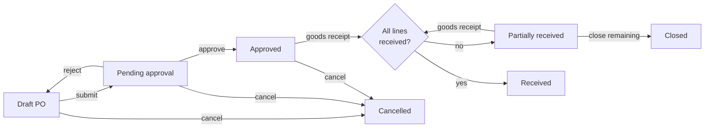
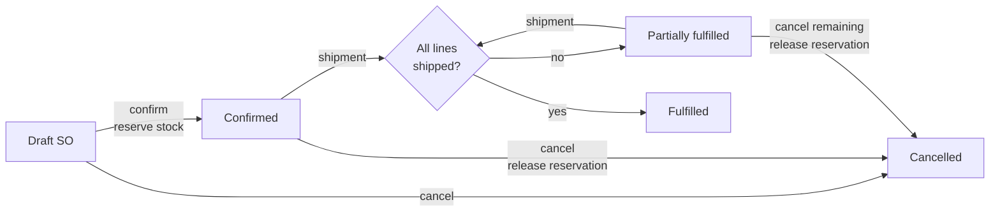
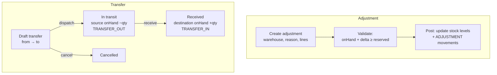
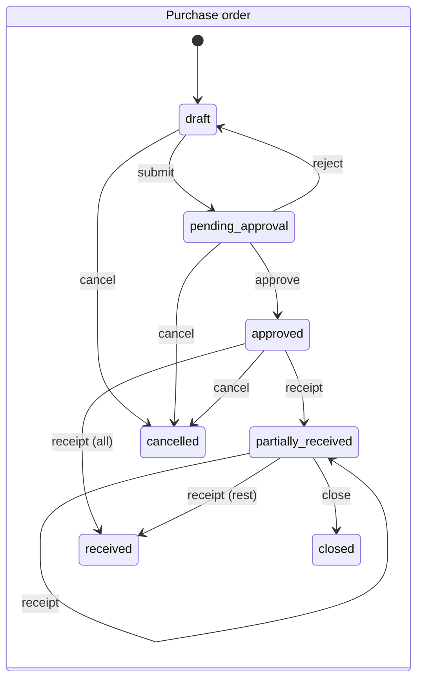
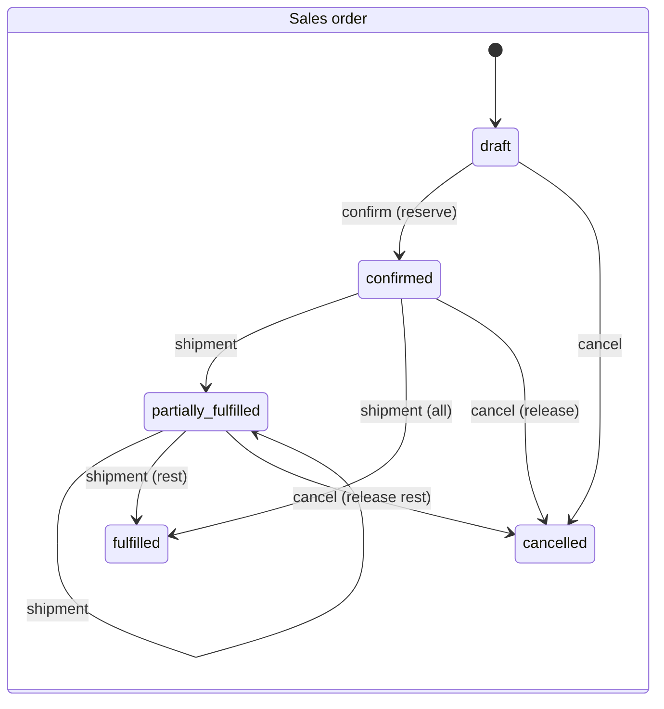
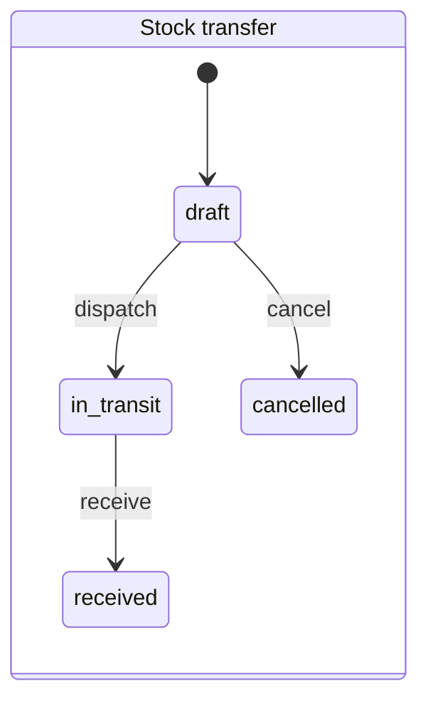
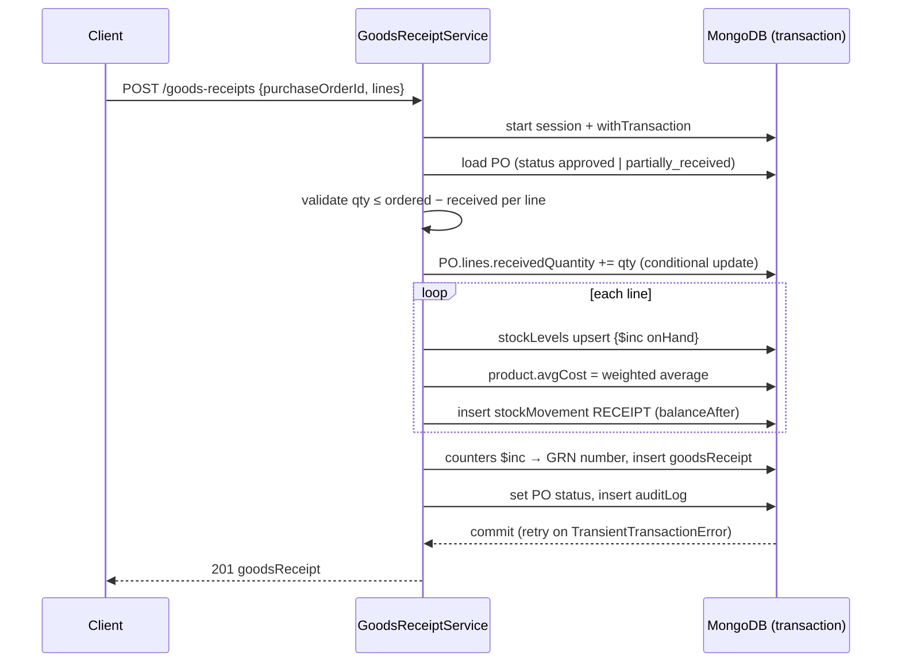
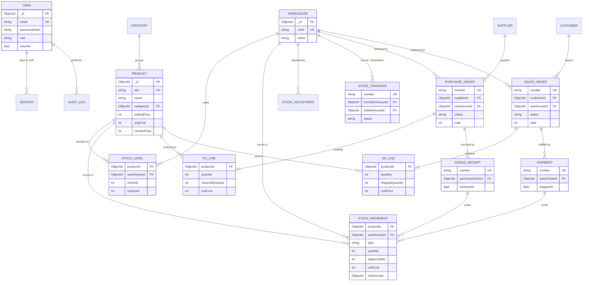
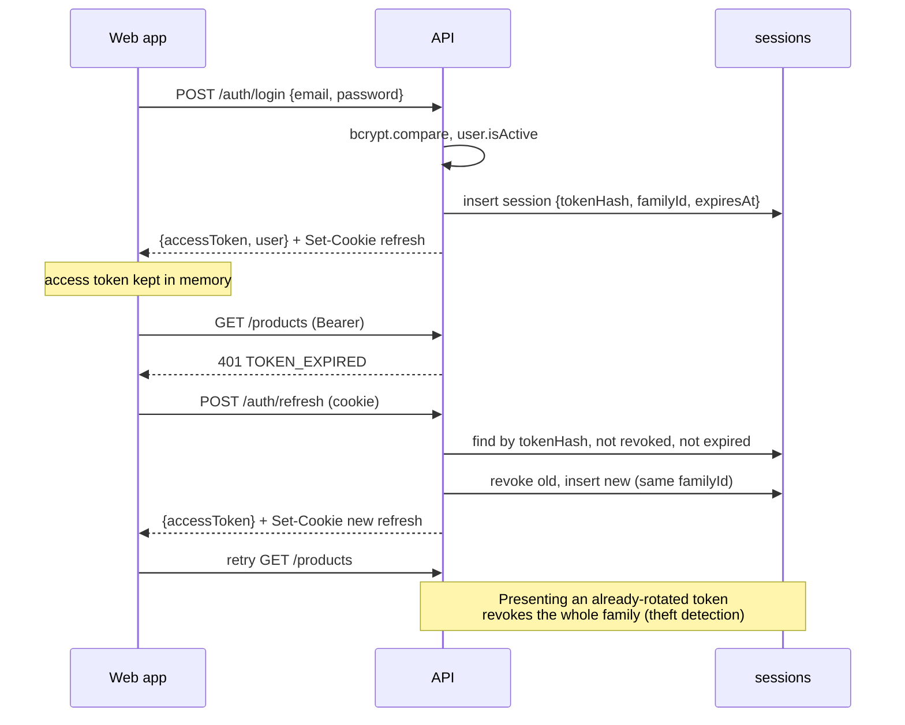
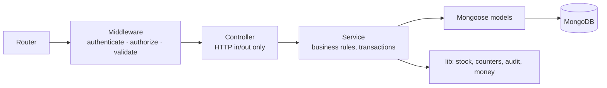

# StockFlow Architecture

StockFlow is an inventory, procurement, warehouse operations and order fulfilment system for one business workspace with multiple users and warehouses.

Contents

1. [Business requirements and roles](#1-business-requirements-and-roles)
2. [Workflows](#2-workflows)
3. [Data model](#3-data-model)
4. [Inventory calculations and consistency rules](#4-inventory-calculations-and-consistency-rules)
5. [Authentication and authorisation](#5-authentication-and-authorisation)
6. [Backend architecture and API](#6-backend-architecture-and-api)
7. [Frontend architecture](#7-frontend-architecture)
8. [Folder structure](#8-folder-structure)
9. [Testing, infrastructure and operations](#9-testing-infrastructure-and-operations)
10. [Key technical decisions](#10-key-technical-decisions)
11. [Implementation roadmap](#11-implementation-roadmap)

---

## 1. Business requirements and roles

### 1.1 Scope

| Area             | In scope                                                                                               |
| ---------------- | ------------------------------------------------------------------------------------------------------ |
| Workspace        | One company: company profile, currency, tax defaults, document number prefixes                         |
| Users            | Email/password accounts created by an admin; five fixed roles                                          |
| Warehouses       | Multiple stock locations; stock tracked per product per warehouse                                      |
| Catalogue        | Categories and products (SKU, unit, prices, tax rate, reorder point)                                   |
| Inventory        | Stock levels, movement ledger, stock adjustments, inter-warehouse transfers, low-stock list, valuation |
| Procurement      | Suppliers, purchase orders with approval, goods receipts (partial)                                     |
| Order fulfilment | Customers, sales orders with stock reservation, shipments (partial)                                    |
| Reporting        | Dashboard, inventory valuation, purchasing and fulfilment summaries                                    |
| Audit            | Log of who changed what and when                                                                       |

### 1.2 Out of scope

These are excluded on purpose to keep the system focused:

- **Financial operations.** Supplier invoices, customer invoices, payment records, payment status tracking, reimbursement workflows and payment gateways. Order documents carry prices and totals so order values can be reported, but StockFlow does not bill, collect or pay.
- OAuth or external identity providers, self-service signup, multiple tenants.
- Multiple currencies. One workspace currency.
- Customer and supplier returns. Stock corrections go through adjustments.
- Lot, serial and expiry tracking, bin locations, product variants, units-of-measure conversion.
- Backorders. A sales order can be confirmed only when the chosen warehouse has enough stock available.

### 1.3 Roles

The roles are fixed and defined in code. Each role maps to a set of permissions (see [§5.3](#53-permissions)).

| Role                    | Key                   | Responsibilities                                                                                                 |
| ----------------------- | --------------------- | ---------------------------------------------------------------------------------------------------------------- |
| **Admin**               | `admin`               | Complete system access, including users, workspace settings and the audit log                                    |
| **Inventory Manager**   | `inventory_manager`   | Products, categories, warehouses and stock: adjustments, transfers, goods receipts, shipments; inventory reports |
| **Procurement Manager** | `procurement_manager` | Suppliers and purchase orders, including approval; purchasing reports                                            |
| **Sales Manager**       | `sales_manager`       | Customers and sales orders; fulfilment reports                                                                   |
| **Staff**               | `staff`               | Restricted operational access: receive goods, ship sales orders, dispatch and receive transfers                  |

Every signed-in user can read master data (products, warehouses, suppliers, customers) and stock levels. Writes need a permission.

---

## 2. Workflows

### 2.1 Procurement



Each goods receipt adds to `onHand` in the PO's destination warehouse, writes `RECEIPT` stock movements and updates the product's average cost. Closing a partly received PO stops waiting for the rest: the remaining quantity no longer counts as incoming.

### 2.2 Order fulfilment



Confirming a sales order reserves stock. A shipment takes the shipped quantity off both `onHand` and `reserved`, and writes `SHIPMENT` movements with the cost at that moment. Cancelling a partly fulfilled order releases only the unshipped reservation. Its shipments stay on record.

### 2.3 Inventory operations



Stock in transit is in neither warehouse. Inventory valuation adds the dispatched-but-unreceived transfer lines as a separate figure.

### 2.4 Document state machines







A transfer cannot be cancelled once dispatched. If the goods never arrive, the destination receives it and records a negative adjustment for the loss, so the ledger shows what happened.

### 2.5 Goods receipt posting (transaction)



Every stock-changing operation follows this pattern: shipments, adjustments, transfer dispatch and receive, sales order confirmation and cancellation.

---

## 3. Data model

### 3.1 Conventions

- **Money** (prices, costs, order totals) is stored as integers in minor units (cents). `1999` means 19.99. Floating-point money is never stored.
- **Tax rates** are stored as integer basis points. `1800` means 18.00%. Tax is calculated so order totals are correct; StockFlow does not keep tax records.
- **Quantities** are integers in the product's base unit. A product sold by weight uses `g` as its unit, not `kg`.
- **Line items** are embedded in their parent document. They are bounded in size and always read with the parent, and updating them in one document keeps the update atomic.
- **Snapshots:** documents copy the party name, product SKU and product name at creation. Historical documents stay correct after master data is renamed.
- **Soft deactivation:** master data (products, warehouses, suppliers, customers, users) is deactivated with `isActive: false`, never deleted, once documents reference it. Draft documents can be hard-deleted.
- **Timestamps:** every collection has `createdAt` and `updatedAt` in UTC. Documents also record `createdBy`.
- **Optimistic concurrency:** Mongoose `optimisticConcurrency: true` is set on order and transfer documents. Status changes use conditional updates such as `findOneAndUpdate({ _id, status: 'approved' }, …)`.

### 3.2 Entity relationship diagram



`STOCK_ADJUSTMENT` and `STOCK_TRANSFER` also write `STOCK_MOVEMENT` records, linked through `reference.type` and `reference.id`. Those edges are left out of the diagram to keep it readable.

### 3.3 Collections

The type notation below is shorthand. `?` means optional, `Ref<X>` is an ObjectId pointing at collection X, and `money` is an integer in minor units.

#### Identity and workspace

```ts
users {
  name: string
  email: string               // lowercased, trimmed
  passwordHash: string        // bcrypt, cost 12
  role: 'admin' | 'inventory_manager' | 'procurement_manager' | 'sales_manager' | 'staff'
  isActive: boolean
  mustChangePassword: boolean // true after admin creates or resets the account
  lastLoginAt?: Date
}
// indexes: { email: 1 } unique

sessions {                    // refresh tokens
  userId: Ref<users>
  tokenHash: string           // SHA-256 of the opaque refresh token
  familyId: string            // rotation chain; reuse of a rotated token revokes the family
  expiresAt: Date
  revokedAt?: Date
  replacedBy?: Ref<sessions>
  userAgent?: string; ip?: string
}
// indexes: { tokenHash: 1 } unique, { userId: 1 }, { familyId: 1 },
//          { expiresAt: 1 } TTL (expireAfterSeconds: 0)

settings {                    // single document, _id: 'workspace'
  companyName: string; address?: string; email?: string; phone?: string
  currency: string            // ISO 4217, e.g. 'USD'
  defaultTaxRate: number      // basis points
  numberPrefixes: { purchaseOrder: 'PO', goodsReceipt: 'GRN', salesOrder: 'SO',
                    shipment: 'SHP', adjustment: 'ADJ', transfer: 'TRF' }
}

counters {                    // gap-free document numbering inside the posting transaction
  _id: string                 // e.g. 'PO-2026'
  seq: number
}
// produces numbers like PO-2026-00042

auditLogs {
  actorId: Ref<users>; actorName: string
  action: string              // 'purchaseOrder.approve', 'user.create', ...
  entityType: string; entityId: ObjectId; entityLabel?: string   // e.g. 'PO-2026-00042'
  changes?: object            // changed fields (before/after) for edits
  ip?: string
  createdAt: Date
}
// indexes: { entityType: 1, entityId: 1, createdAt: -1 }, { actorId: 1, createdAt: -1 }, { createdAt: -1 }
```

#### Master data

```ts
warehouses {
  code: string                // short unique code, uppercase
  name: string; address?: string
  isActive: boolean
}
// indexes: { code: 1 } unique

categories {
  name: string; description?: string
}
// indexes: { name: 1 } unique (collation strength 2 for case-insensitive uniqueness)

products {
  sku: string; name: string; description?: string
  categoryId?: Ref<categories>
  unit: string                // 'pcs', 'box', 'g', 'm' ...
  barcode?: string
  costPrice: money            // default purchase price for new POs
  sellingPrice: money         // default price for new SOs
  taxRate: number             // basis points
  avgCost: money              // moving weighted average, maintained by receipts
  reorderPoint: number        // per-warehouse threshold
  reorderQuantity: number     // suggested PO quantity
  isActive: boolean
}
// indexes: { sku: 1 } unique, { barcode: 1 } unique partial (barcode exists),
//          { categoryId: 1 }, { isActive: 1, name: 1 },
//          text index { name, sku, barcode } for search

suppliers / customers {       // same shape, separate collections
  code: string; name: string
  contactName?: string; email?: string; phone?: string
  address?: string            // customers also: shippingAddress?
  leadTimeDays?: number       // suppliers only: default expected delivery offset for new POs
  notes?: string
  isActive: boolean
}
// indexes: { code: 1 } unique, { isActive: 1, name: 1 }, text { name, code, email }
```

#### Inventory

```ts
stockLevels {
  productId: Ref<products>
  warehouseId: Ref<warehouses>
  onHand: number              // physically in the warehouse
  reserved: number            // committed to confirmed sales orders
}
// indexes: { productId: 1, warehouseId: 1 } unique, { warehouseId: 1 }
// schema validator: onHand ≥ 0, reserved ≥ 0 (enforced by conditional updates too)

stockMovements {              // append-only ledger, never updated or deleted
  productId: Ref<products>; warehouseId: Ref<warehouses>
  type: 'RECEIPT' | 'SHIPMENT' | 'ADJUSTMENT' | 'TRANSFER_OUT' | 'TRANSFER_IN'
  quantity: number            // signed: + into the warehouse, − out
  balanceAfter: number        // onHand after this movement
  unitCost: money             // receipt: PO cost; others: avgCost at the time
  reference: { type: 'goodsReceipt' | 'shipment' | 'adjustment' | 'transfer', id: ObjectId, number: string }
  note?: string
  createdBy: Ref<users>; createdAt: Date
}
// indexes: { productId: 1, warehouseId: 1, createdAt: -1 },
//          { warehouseId: 1, createdAt: -1 }, { 'reference.id': 1 }, { type: 1, createdAt: -1 }

stockAdjustments {
  number: string
  warehouseId: Ref<warehouses>
  reason: 'count' | 'damage' | 'loss' | 'found' | 'other'
  notes?: string
  lines: [{ productId, sku, name, quantityChange: number /* signed, ≠ 0 */, previousOnHand: number, unitCost: money }]
  createdBy; createdAt
}
// posted at creation; immutable
// indexes: { number: 1 } unique, { warehouseId: 1, createdAt: -1 }

stockTransfers {
  number: string
  fromWarehouseId: Ref<warehouses>; toWarehouseId: Ref<warehouses>   // must differ
  status: 'draft' | 'in_transit' | 'received' | 'cancelled'
  lines: [{ productId, sku, name, quantity: number, unitCost: money /* set at dispatch */ }]
  notes?: string
  dispatchedAt?: Date; dispatchedBy?: Ref<users>
  receivedAt?: Date; receivedBy?: Ref<users>
  idempotencyKey?: string
  createdBy
}
// indexes: { number: 1 } unique, { status: 1, createdAt: -1 }, { fromWarehouseId: 1 }, { toWarehouseId: 1 }
```

#### Procurement

```ts
purchaseOrders {
  number: string
  supplierId: Ref<suppliers>; supplierName: string
  warehouseId: Ref<warehouses>          // destination
  status: 'draft' | 'pending_approval' | 'approved' | 'partially_received' | 'received' | 'closed' | 'cancelled'
  orderDate: Date; expectedDate?: Date
  lines: [{
    _id: ObjectId
    productId; sku; name; unit
    quantity: number                    // > 0
    receivedQuantity: number            // ≤ quantity
    unitCost: money; taxRate: number
    lineSubtotal: money; lineTax: money; lineTotal: money
  }]
  subtotal: money; taxTotal: money; total: money
  notes?: string
  submittedAt?; approvedBy?: Ref<users>; approvedAt?
  rejectionReason?: string
  closedAt?; closedBy?; cancelledAt?; cancelledBy?; cancelReason?
  createdBy
}
// indexes: { number: 1 } unique, { status: 1, orderDate: -1 }, { supplierId: 1, orderDate: -1 },
//          { warehouseId: 1, status: 1 }, { 'lines.productId': 1, status: 1 }  // incoming qty

goodsReceipts {
  number: string
  purchaseOrderId: Ref<purchaseOrders>; purchaseOrderNumber: string
  supplierId; warehouseId
  receivedAt: Date
  lines: [{ poLineId: ObjectId, productId, sku, name, quantity: number, unitCost: money }]
  notes?: string
  idempotencyKey?: string
  createdBy
}
// indexes: { number: 1 } unique, { purchaseOrderId: 1 }, { receivedAt: -1 },
//          { idempotencyKey: 1 } unique partial
```

#### Order fulfilment

```ts
salesOrders {
  number: string
  customerId: Ref<customers>; customerName: string
  warehouseId: Ref<warehouses>          // fulfilling warehouse
  status: 'draft' | 'confirmed' | 'partially_fulfilled' | 'fulfilled' | 'cancelled'
  orderDate: Date; requiredDate?: Date; shippingAddress?: string
  lines: [{
    _id; productId; sku; name; unit
    quantity: number
    shippedQuantity: number             // ≤ quantity
    unitPrice: money; discount: money   // discount is per line, absolute
    taxRate: number
    lineSubtotal; lineTax; lineTotal
  }]
  subtotal; taxTotal; total
  notes?; confirmedAt?; confirmedBy?; cancelledAt?; cancelledBy?; cancelReason?
  createdBy
}
// indexes: { number: 1 } unique, { status: 1, orderDate: -1 }, { customerId: 1, orderDate: -1 },
//          { warehouseId: 1, status: 1 }, { 'lines.productId': 1, status: 1 }

shipments {
  number: string
  salesOrderId; salesOrderNumber; customerId; warehouseId
  shippedAt: Date
  carrier?: string; trackingNumber?: string
  lines: [{ soLineId, productId, sku, name, quantity, unitCost: money /* avgCost at shipment → COGS */ }]
  notes?: string
  idempotencyKey?: string
  createdBy
}
// indexes: { number: 1 } unique, { salesOrderId: 1 }, { shippedAt: -1 }, { idempotencyKey: 1 } unique partial
```

---

## 4. Inventory calculations and consistency rules

### 4.1 Quantities

| Figure            | Definition                                                                                                   | Stored or derived       |
| ----------------- | ------------------------------------------------------------------------------------------------------------ | ----------------------- |
| `onHand`          | Units physically in a warehouse                                                                              | Stored on `stockLevels` |
| `reserved`        | Units committed to confirmed, unshipped sales order lines                                                    | Stored on `stockLevels` |
| `available`       | `onHand − reserved`                                                                                          | Derived                 |
| `incoming`        | Σ `(quantity − receivedQuantity)` over lines of POs in `approved` or `partially_received` for that warehouse | Derived (aggregation)   |
| `inTransit`       | Σ line quantities of transfers in `in_transit`, by destination                                               | Derived                 |
| Low stock         | `available ≤ product.reorderPoint` in a warehouse (only when `reorderPoint > 0`)                             | Derived                 |
| Suggested reorder | `max(reorderQuantity, reorderPoint − available − incoming)`                                                  | Derived                 |

### 4.2 Costing: moving weighted average

`product.avgCost` is one value per product, shared by all warehouses. It is recalculated on every goods receipt line:

```
Q   = total onHand of the product across all warehouses, before the receipt
q   = received quantity,  c = PO line unit cost
avgCost' = Q ≤ 0 ? c : round((Q × avgCost + q × c) / (Q + q))
```

- Shipments, negative adjustments and transfer dispatches record `unitCost = avgCost` at that moment. For shipments this gives the cost of goods shipped.
- Transfers and adjustments do not change `avgCost`.
- Inventory valuation is Σ `onHand × avgCost`, plus in-transit transfer value at the cost recorded on dispatch.
- Rounding is half-up to the nearest minor unit. The helpers live in `packages/shared/money.ts`.

### 4.3 Order totals

For each line:

```
lineSubtotal = quantity × unitPrice − discount                 // purchases: quantity × unitCost
lineTax      = round(lineSubtotal × taxRate / 10000)
lineTotal    = lineSubtotal + lineTax
```

`subtotal`, `taxTotal` and `total` are sums of the line values. Tax is rounded per line. The frontend uses the same shared function for previews, but the server always recalculates and ignores totals sent by the client.

### 4.4 Invariants

These must hold at all times. Integration tests assert them.

1. `stockLevels.onHand ≥ 0` and `0 ≤ reserved ≤ onHand`.
2. `onHand` for a (product, warehouse) equals Σ `stockMovements.quantity` for that pair (ledger reconciliation).
3. PO line: `0 ≤ receivedQuantity ≤ quantity`.
4. SO line: `0 ≤ shippedQuantity ≤ quantity`.
5. Σ `reserved` per (product, warehouse) equals Σ `(quantity − shippedQuantity)` over lines of `confirmed` and `partially_fulfilled` SOs for that warehouse.
6. Every posted receipt, shipment, adjustment and transfer has matching movement records whose quantities sum to the document's lines.
7. Posted stock documents (receipts, shipments, adjustments, dispatched transfers) are never edited or deleted. Mistakes are corrected with a new adjustment.

### 4.5 How consistency is enforced

| Operation         | Stock effect                       | Guard                                                                                                                                                                                            |
| ----------------- | ---------------------------------- | ------------------------------------------------------------------------------------------------------------------------------------------------------------------------------------------------ |
| SO confirm        | `reserved += q`                    | `updateOne({productId, warehouseId, $expr: {$gte: [{$subtract: ['$onHand','$reserved']}, q]}}, {$inc: {reserved: q}})`. If no document matches, the transaction aborts with `INSUFFICIENT_STOCK` |
| SO cancel         | `reserved −= (quantity − shipped)` | Status condition on the SO                                                                                                                                                                       |
| Shipment          | `onHand −= q`, `reserved −= q`     | `q ≤ quantity − shippedQuantity` (conditional update on the SO line), `reserved ≥ q`                                                                                                             |
| Goods receipt     | `onHand += q` (upsert)             | `q ≤ quantity − receivedQuantity` (conditional update on the PO line)                                                                                                                            |
| Adjustment        | `onHand += delta`                  | For negative deltas: `onHand + delta ≥ reserved`                                                                                                                                                 |
| Transfer dispatch | source `onHand −= q`               | `onHand − reserved ≥ q`                                                                                                                                                                          |
| Transfer receive  | destination `onHand += q` (upsert) | Status `in_transit`                                                                                                                                                                              |

- Every row above runs inside `session.withTransaction()`. The stock level update, ledger insert, parent document update, document number and audit entry commit together or not at all. The driver retries the transaction on write conflicts.
- The guards are conditional updates on the server, not read-then-write checks. When two requests race for the last units, exactly one succeeds. A concurrency test covers this.
- Status changes check the expected current status in the update filter. A double submit therefore cannot apply twice.
- Stock-posting `POST` endpoints accept an optional `Idempotency-Key` header. It is stored with a unique partial index, so a retried request returns the original document instead of posting again.
- MongoDB transactions need a replica set. Development, CI and Docker run a single-node replica set, and tests use `mongodb-memory-server` in replica-set mode.

---

## 5. Authentication and authorisation

### 5.1 Tokens

| Token   | Format                                          | Lifetime   | Storage on client                                                   | Transport               |
| ------- | ----------------------------------------------- | ---------- | ------------------------------------------------------------------- | ----------------------- |
| Access  | JWT (HS256), claims `sub`, `role`, `iat`, `exp` | 15 minutes | Memory only (auth context)                                          | `Authorization: Bearer` |
| Refresh | 256-bit random, opaque                          | 7 days     | `httpOnly`, `Secure`, `SameSite=Strict` cookie, `Path=/api/v1/auth` | Cookie                  |



- On page load the app calls `/auth/refresh` to restore the session. Concurrent 401 responses share a single in-flight refresh promise.
- Logout revokes the session and clears the cookie. When an admin resets a password or deactivates a user, all of that user's sessions are revoked.
- The `authenticate` middleware verifies the JWT and then loads the user from the database on every request (a small indexed `_id` lookup). Deactivating a user or changing a role takes effect immediately, without waiting for the access token to expire.

### 5.2 Account security

- bcrypt with cost 12. Minimum password length 10, maximum 128.
- There is no public signup. The first admin comes from the seed script or the `BOOTSTRAP_ADMIN_*` environment variables when the users collection is empty. Admins create every other user with a temporary password and `mustChangePassword: true`. Until the password is changed, the API allows only `/auth/me`, `/auth/change-password` and `/auth/logout`.
- `/auth/login` is rate-limited per IP and per email (`express-rate-limit`). Login errors are generic, so they don't reveal whether an email exists.
- `helmet`, a CORS allowlist from config, a JSON body limit and `trust proxy` configured for the reverse proxy.
- CSRF: the API authenticates through the bearer header, which cross-site requests cannot attach. The only cookie is path-scoped to the auth routes and set `SameSite=Strict`.

### 5.3 Permissions

Permissions are string constants in `packages/shared/permissions.ts`, together with the role → permission map. The server enforces them with `authorize(permission)` middleware. The client uses the same map only to hide navigation and actions.

| Permission               | Admin | Inventory Mgr | Procurement Mgr | Sales Mgr | Staff |
| ------------------------ | :---: | :-----------: | :-------------: | :-------: | :---: |
| `users:manage`           |   ✓   |               |                 |           |       |
| `settings:manage`        |   ✓   |               |                 |           |       |
| `audit:read`             |   ✓   |               |                 |           |       |
| `warehouses:manage`      |   ✓   |       ✓       |                 |           |       |
| `categories:manage`      |   ✓   |       ✓       |                 |           |       |
| `products:write`         |   ✓   |       ✓       |                 |           |       |
| `stock:adjust`           |   ✓   |       ✓       |                 |           |       |
| `stock:transfer`         |   ✓   |       ✓       |                 |           |   ✓   |
| `goodsReceipts:create`   |   ✓   |       ✓       |                 |           |   ✓   |
| `shipments:create`       |   ✓   |       ✓       |                 |           |   ✓   |
| `suppliers:write`        |   ✓   |               |        ✓        |           |       |
| `purchaseOrders:write`   |   ✓   |               |        ✓        |           |       |
| `purchaseOrders:approve` |   ✓   |               |        ✓        |           |       |
| `customers:write`        |   ✓   |               |                 |     ✓     |       |
| `salesOrders:write`      |   ✓   |               |                 |     ✓     |       |
| `reports:inventory`      |   ✓   |       ✓       |                 |           |       |
| `reports:purchasing`     |   ✓   |               |        ✓        |           |       |
| `reports:fulfilment`     |   ✓   |               |                 |     ✓     |       |

- **Read access:** any signed-in user can read master data, stock, purchase orders and sales orders. Reports need the matching `reports:*` permission, because inventory valuation exposes cost figures.
- **Separation of duties:** a purchase order cannot be approved by the user who created it, unless that user is an admin. A procurement manager's own POs need approval from another procurement manager or an admin.

---

## 6. Backend architecture and API

### 6.1 Layers



- **Feature modules:** each domain folder holds its model, routes and service. Route handlers act as the controllers.
- **Route handlers** parse the input with its Zod schema, call a service and shape the response. They contain no business logic.
- **Services** own the rules. They take a `ctx` (`{ user, session? }`) so they can be composed inside one transaction. For example, `goodsReceiptService.create` calls `stockService.applyMovement` with the same session.
- **`stockService`** is the only code that writes `stockLevels` or `stockMovements`.
- **Validation:** Zod schemas in `packages/shared` are parsed in route handlers (a `ZodError` becomes a 400 `VALIDATION_ERROR` with field details) and reused by the frontend forms.
- **Config:** `env.ts` parses `process.env` with Zod at startup. Missing or invalid configuration stops the process.

### 6.2 Conventions

- Base path `/api/v1`. JSON only.
- List endpoints: `?page=1&pageSize=25&sort=-createdAt&search=…&<filters>`. The response is `{ data: [...], meta: { page, pageSize, total } }`, with `pageSize ≤ 100`.
- Single resource: `{ data: {...} }`.
- Errors: `{ error: { code, message, details? } }`, with stable codes such as `VALIDATION_ERROR` (400, field details), `UNAUTHENTICATED` and `TOKEN_EXPIRED` (401), `FORBIDDEN` (403), `NOT_FOUND` (404), `CONFLICT`, `INVALID_STATE` and `INSUFFICIENT_STOCK` (409), and `RATE_LIMITED` (429). Unknown errors return 500 with a generic message and are logged with their stack.
- Actions are sub-resources: `POST /purchase-orders/:id/approve`. They are not done by `PATCH`ing the status.
- Logging: `pino` with `pino-http`. A request ID is generated or taken from `X-Request-Id`, returned in a header and included in every log line. Passwords, tokens and cookies are redacted.

### 6.3 Endpoints

| Area            | Endpoints                                                                                                                                                                                                                                                                                              | Permission                          |
| --------------- | ------------------------------------------------------------------------------------------------------------------------------------------------------------------------------------------------------------------------------------------------------------------------------------------------------ | ----------------------------------- |
| Health          | `GET /health` (checks the DB ping)                                                                                                                                                                                                                                                                     | public                              |
| Auth            | `POST /auth/login`, `POST /auth/refresh`, `POST /auth/logout`, `GET /auth/me`, `POST /auth/change-password`                                                                                                                                                                                            | public / authenticated              |
| Users           | `GET /users`, `POST /users`, `GET /users/:id`, `PATCH /users/:id` (name, role, isActive), `POST /users/:id/reset-password`                                                                                                                                                                             | `users:manage`                      |
| Settings        | `GET /settings`, `PATCH /settings`                                                                                                                                                                                                                                                                     | read: any; write: `settings:manage` |
| Audit           | `GET /audit-logs?entityType&entityId&actorId&from&to`                                                                                                                                                                                                                                                  | `audit:read`                        |
| Warehouses      | `GET`, `POST /warehouses`, `GET`, `PATCH /warehouses/:id`                                                                                                                                                                                                                                              | write: `warehouses:manage`          |
| Categories      | `GET`, `POST /categories`, `PATCH`, `DELETE /categories/:id` (only when unused)                                                                                                                                                                                                                        | write: `categories:manage`          |
| Products        | `GET /products?search&categoryId&isActive&lowStock`, `POST`, `GET /products/:id` (with stock per warehouse), `PATCH /products/:id`                                                                                                                                                                     | write: `products:write`             |
| Suppliers       | `GET`, `POST /suppliers`, `GET`, `PATCH /suppliers/:id` (detail includes open POs)                                                                                                                                                                                                                     | write: `suppliers:write`            |
| Customers       | `GET`, `POST /customers`, `GET`, `PATCH /customers/:id` (detail includes open SOs)                                                                                                                                                                                                                     | write: `customers:write`            |
| Stock           | `GET /stock/levels?productId&warehouseId&lowStock`, `GET /stock/movements?productId&warehouseId&type&from&to`, `GET /stock/low-stock`                                                                                                                                                                  | any                                 |
| Adjustments     | `GET /stock-adjustments`, `POST /stock-adjustments` (posts immediately), `GET /stock-adjustments/:id`                                                                                                                                                                                                  | write: `stock:adjust`               |
| Transfers       | `GET`, `POST /stock-transfers`, `GET`, `PATCH`, `DELETE /stock-transfers/:id` (draft), `POST /stock-transfers/:id/dispatch`, `/receive`, `/cancel`                                                                                                                                                     | write: `stock:transfer`             |
| Purchase orders | `GET`, `POST /purchase-orders`, `GET`, `PATCH`, `DELETE /purchase-orders/:id` (draft), `POST /purchase-orders/:id/submit`, `/cancel`, `/close`                                                                                                                                                         | `purchaseOrders:write`              |
|                 | `POST /purchase-orders/:id/approve`, `/reject`                                                                                                                                                                                                                                                         | `purchaseOrders:approve`            |
| Goods receipts  | `GET /goods-receipts?purchaseOrderId`, `POST /goods-receipts`, `GET /goods-receipts/:id`                                                                                                                                                                                                               | write: `goodsReceipts:create`       |
| Sales orders    | `GET`, `POST /sales-orders`, `GET`, `PATCH`, `DELETE /sales-orders/:id` (draft), `POST /sales-orders/:id/confirm`, `/cancel`                                                                                                                                                                           | `salesOrders:write`                 |
| Shipments       | `GET /shipments?salesOrderId`, `POST /shipments`, `GET /shipments/:id`                                                                                                                                                                                                                                 | write: `shipments:create`           |
| Reports         | `GET /reports/dashboard` (figures limited to the caller's permissions), `GET /reports/inventory-valuation?warehouseId` and `/stock-turnover?from&to` (`reports:inventory`), `/purchasing-summary?from&to&groupBy` (`reports:purchasing`), `/fulfilment-summary?from&to&groupBy` (`reports:fulfilment`) | dashboard: any                      |

Reports are MongoDB aggregations over the source documents. Nothing is pre-aggregated, which is fast enough at SMB data volumes given the indexes above.

- **Purchasing summary:** PO count and value by supplier or period, receipt timeliness (`receivedAt` against `expectedDate`).
- **Fulfilment summary:** SO count, order value and units shipped by customer or period, and average days from confirmation to full shipment.
- **Stock turnover:** units shipped and cost of goods shipped against average inventory value, per product.

---

## 7. Frontend architecture

### 7.1 Structure

- **Routing:** React Router with a data-router layout. The `RequireAuth` route guard handles redirects to login and forced password changes. `RequirePermission` wraps admin pages and renders a 403 page.
- **Server state:** TanStack Query only, with no separate client store. Query keys are per feature (`['purchaseOrders', 'list', params]`). Mutations invalidate the related keys. Posting a receipt, for example, invalidates the PO, stock and product queries.
- **API client:** a thin `fetch` wrapper that attaches the bearer token, refreshes once on `TOKEN_EXPIRED`, and turns error responses into a typed `ApiError`.
- **Forms:** `react-hook-form` with `zodResolver`, using the shared schemas and shadcn `Form` components. Server `VALIDATION_ERROR` details are mapped back onto the fields.
- **Tables:** one `DataTable` component built on TanStack Table, with server-side pagination, sorting and filters kept in the URL search params so views can be linked and survive a reload.
- **Feedback:** toasts for completed actions, inline errors for failures, confirmation dialogs for irreversible actions (approve, post, dispatch, cancel), and skeleton rows while loading.
- **Money input and display:** the user types decimals and the app stores minor units. Display uses `Intl.NumberFormat` with the workspace currency.

### 7.2 Navigation

The sidebar is grouped. Items the user lacks permission for are hidden.

| Group      | Pages                                                     |
| ---------- | --------------------------------------------------------- |
| —          | Dashboard                                                 |
| Inventory  | Products, Stock levels, Movements, Adjustments, Transfers |
| Purchasing | Purchase orders, Goods receipts, Suppliers                |
| Fulfilment | Sales orders, Shipments, Customers                        |
| —          | Reports                                                   |
| Admin      | Users, Warehouses, Categories, Settings, Audit log        |

The top bar has a global warehouse filter that defaults to "All warehouses" and is applied to stock views. It also has the user menu: profile, change password and sign out.

### 7.3 Pages

| Page                   | Contents                                                                                                                                                                   |
| ---------------------- | -------------------------------------------------------------------------------------------------------------------------------------------------------------------------- |
| Login, Change password | Minimal forms                                                                                                                                                              |
| Dashboard              | Low-stock count and list, POs awaiting approval, POs due or overdue for delivery, SOs waiting to ship, transfers in transit, recent movements; value figures by permission |
| Products               | List (search, category, active, low stock) → detail (stock per warehouse, incoming, movements, open orders) → create/edit form                                             |
| Stock levels           | Product × warehouse grid: on hand, reserved, available, incoming                                                                                                           |
| Movements              | Ledger with filters; each row links to its source document                                                                                                                 |
| Adjustments            | List, create form with line editor (shows current on-hand)                                                                                                                 |
| Transfers              | List, form, detail with dispatch, receive and cancel actions                                                                                                               |
| Purchase orders        | List with status tabs, form with line editor and totals, detail with timeline, actions by status and permission, receipts tab                                              |
| Goods receipt          | Started from a PO: remaining quantity per line, enter quantity received                                                                                                    |
| Sales orders           | List with status tabs, form (available stock shown per line for the chosen warehouse), detail with confirm, ship and cancel actions, shipments tab                         |
| Shipment               | Started from an SO: remaining quantity per line, carrier and tracking number                                                                                               |
| Suppliers / Customers  | List, detail (open and recent orders), form                                                                                                                                |
| Reports                | Inventory valuation, purchasing summary, fulfilment summary, stock turnover                                                                                                |
| Admin pages            | Users (create, role, deactivate, reset password), warehouses, categories, settings, audit log                                                                              |

### 7.4 Shared components

`AppShell`, `Sidebar`, `PageHeader` (title and actions), `DataTable`, `FilterBar`, `StatusBadge` (one colour map for all document statuses), `MoneyInput`, `Money`, `QuantityInput`, `EntityCombobox` (async search for products, suppliers, customers and warehouses), `LineItemsEditor` (shared by POs, SOs, receipts, shipments, adjustments and transfers through column configuration), `DocumentTotals`, `ConfirmDialog`, `EmptyState`, `ErrorState`, `PermissionGate`. Primitives come from shadcn/ui under `components/ui`.

---

## 8. Folder structure

The repository is an npm workspaces monorepo:

```
stockflow/
├── apps/
│   ├── api/
│   │   ├── src/
│   │   │   ├── config/            env.ts (Zod), db.ts, logger.ts
│   │   │   ├── middleware/        authenticate, authorize, validate, error-handler, request-id, rate-limit
│   │   │   ├── lib/               errors.ts, transaction.ts, pagination.ts, counters.ts, audit.ts
│   │   │   ├── modules/
│   │   │   │   ├── auth/          auth.routes.ts, auth.service.ts, session.model.ts, tokens.ts
│   │   │   │   ├── users/
│   │   │   │   ├── settings/
│   │   │   │   ├── audit/
│   │   │   │   ├── warehouses/
│   │   │   │   ├── categories/
│   │   │   │   ├── products/
│   │   │   │   ├── suppliers/
│   │   │   │   ├── customers/
│   │   │   │   ├── stock/         stock-level.model.ts, stock-movement.model.ts, stock.service.ts, adjustments/, transfers/
│   │   │   │   ├── purchasing/    purchase-orders/, goods-receipts/
│   │   │   │   ├── fulfilment/    sales-orders/, shipments/
│   │   │   │   └── reports/
│   │   │   ├── routes.ts          mounts module routers under /api/v1
│   │   │   ├── app.ts             express app factory (used by tests)
│   │   │   └── server.ts          starts HTTP server, graceful shutdown
│   │   ├── scripts/seed.ts
│   │   ├── tests/                 setup (memory replica set), factories, *.test.ts per workflow
│   │   ├── Dockerfile
│   │   └── package.json
│   └── web/
│       ├── src/
│       │   ├── app/               router.tsx, providers.tsx, layout/ (AppShell, Sidebar, Topbar)
│       │   ├── components/
│       │   │   ├── ui/            shadcn/ui primitives
│       │   │   └── …              DataTable, PageHeader, LineItemsEditor, MoneyInput, StatusBadge, …
│       │   ├── features/
│       │   │   ├── auth/          api.ts, AuthProvider.tsx, LoginPage.tsx, …
│       │   │   ├── products/      api.ts (query/mutation hooks), pages/, components/
│       │   │   └── …              one folder per domain, mirroring the API modules
│       │   ├── lib/               api-client.ts, query-client.ts, format.ts, utils.ts
│       │   └── main.tsx
│       ├── e2e/                   Playwright specs
│       ├── Dockerfile             build → nginx (serves SPA, proxies /api)
│       ├── nginx.conf
│       └── package.json
├── packages/
│   └── shared/
│       └── src/                   schemas/ (Zod per domain), permissions.ts, enums.ts, money.ts, index.ts
├── docker/mongo/                  replica-set init script
├── docker-compose.yml             mongo (rs0), api, web
├── .github/workflows/ci.yml
├── docs/ARCHITECTURE.md
├── IMPLEMENTATION_LOG.md
├── README.md
├── package.json                   workspaces, root scripts
└── tsconfig.base.json
```

---

## 9. Testing, infrastructure and operations

### 9.1 Testing

Vitest runs both apps and the shared package.

| Layer           | Tool                                                       | Focus                                                                                                                                                                                                                 |
| --------------- | ---------------------------------------------------------- | --------------------------------------------------------------------------------------------------------------------------------------------------------------------------------------------------------------------- |
| Shared unit     | Vitest                                                     | Money rounding, line and order totals, average cost formula, permission map                                                                                                                                           |
| API integration | Vitest + Supertest + `mongodb-memory-server` (replica set) | Each workflow end to end through HTTP. Covers auth (login, refresh rotation, reuse detection, deactivation), RBAC denials, the PO lifecycle and partial receipts, SO reserve, ship and cancel, adjustments, transfers |
| Concurrency     | Same harness                                               | Parallel confirms, shipments and dispatches competing for the last units: exactly one succeeds, invariants hold                                                                                                       |
| Invariants      | Test helper                                                | After each workflow test: ledger matches `onHand`, reservations match open SO lines, line quantities stay within bounds                                                                                               |
| Web component   | Vitest + Testing Library                                   | `LineItemsEditor`, `MoneyInput`, API client refresh logic                                                                                                                                                             |
| E2E             | Playwright against the Docker stack with seed data         | Login; PO create → approve → receive → stock increases; SO create → confirm → ship → stock decreases; transfer dispatch → receive; role-based visibility                                                              |

### 9.2 Docker and CI

- `docker-compose.yml` has three services. `mongo` (8.0) runs as a single-node replica set initialised by a script, with a healthcheck. `api` runs Node 22 on a multi-stage build and starts once `mongo` is healthy. `web` builds the SPA and serves it with nginx, which proxies `/api` to `api` so browser and API share an origin.
- GitHub Actions, on every push and PR: install with cache → lint (ESLint) → typecheck → unit and integration tests → build → Playwright against `docker compose up`, uploading the report as an artifact.

### 9.3 Seed data

`npm run seed` resets the development database. It then creates the workspace settings, one user per role, three warehouses, categories, about 40 products, suppliers and customers. Purchase orders, receipts, sales orders, shipments, adjustments and transfers are created through the services rather than inserted directly, so their stock levels and ledger are consistent. The seed refuses to run when `NODE_ENV=production`.

---

## 10. Key technical decisions

| #   | Decision                                                                                                | Reason                                                                                   | Trade-off                                                                       |
| --- | ------------------------------------------------------------------------------------------------------- | ---------------------------------------------------------------------------------------- | ------------------------------------------------------------------------------- |
| 1   | No invoicing, payments or financial status tracking                                                     | Keeps the product focused on inventory, procurement, warehouse operations and fulfilment | Order prices and totals are informational; billing happens in another system    |
| 2   | MongoDB replica set and multi-document transactions for every stock posting                             | Stock levels, ledger, order lines and numbering must change together                     | A replica set is needed even in development (single node in Docker and tests)   |
| 3   | Conditional atomic updates as stock guards, inside the transaction                                      | Prevents overselling under concurrent requests without application-level locks           | Guards must be written carefully per operation and covered by concurrency tests |
| 4   | Separate `stockLevels` (current state) and an append-only `stockMovements` (ledger)                     | Fast reads of current stock plus a full audit trail that can be reconciled               | Two writes per change, both in one transaction                                  |
| 5   | Integer minor units for money, basis points for tax, integer quantities                                 | Exact arithmetic without decimal libraries                                               | Fractional quantities must use a smaller base unit                              |
| 6   | Moving weighted average cost per product                                                                | Standard for SMBs; simple and stable valuation and cost of goods shipped                 | Not FIFO; cost is shared across warehouses                                      |
| 7   | Embedded line items with snapshots                                                                      | Atomic document updates; historical accuracy                                             | Product renames don't change old documents (intended)                           |
| 8   | Reservation at SO confirmation, no backorders                                                           | Keeps `available` meaningful; simpler fulfilment                                         | Orders larger than available stock must wait for stock or be split              |
| 9   | Two-step transfers (dispatch, receive)                                                                  | Matches physical reality; in-transit stock is visible                                    | One extra action compared with an instant transfer                              |
| 10  | Fixed roles with a permission map in a shared package                                                   | Covers the business needs; one source of truth for API and UI                            | Custom roles would need a schema change later                                   |
| 11  | Short-lived JWT in memory and a rotating refresh token in an httpOnly cookie, user reloaded per request | XSS cannot read the refresh token; deactivation and role changes apply immediately       | One user lookup per request                                                     |
| 12  | Shared Zod schemas between web and api                                                                  | One validation definition; typed forms and requests                                      | The shared package must stay free of Node-only and browser-only code            |
| 13  | Offset pagination                                                                                       | Page numbers suit back-office tables; data volumes are modest                            | Slower on very deep pages (not expected here)                                   |
| 14  | Reports computed by aggregation, not stored                                                             | No duplicated state to keep in sync                                                      | Heavier queries; mitigated by indexes                                           |
| 15  | Vitest everywhere, Playwright for E2E                                                                   | One unit and integration runner, native TypeScript and ESM                               | —                                                                               |
| 16  | Feature-module layout on both api and web                                                               | Each domain is self-contained; phases add folders without reshaping existing code        | Some repeated boilerplate per module                                            |

Dependencies beyond the required stack are limited to: `react-hook-form` and `@hookform/resolvers` (shadcn forms), `@tanstack/react-table`, `pino` and `pino-http`, `helmet`, `cors`, `cookie-parser`, `express-rate-limit`, `jsonwebtoken`, `bcrypt`, and `mongodb-memory-server` (tests only).

---

## 11. Implementation roadmap

Each phase ends with passing tests, an `IMPLEMENTATION_LOG.md` entry and a commit. If you supply a different phase breakdown, it replaces this one.

| Phase                         | Deliverable                                                                                                                                                                                                                                                                                                           | Done when                                                                        |
| ----------------------------- | --------------------------------------------------------------------------------------------------------------------------------------------------------------------------------------------------------------------------------------------------------------------------------------------------------------------- | -------------------------------------------------------------------------------- |
| **0. Architecture**           | This document, implementation log, repository initialised                                                                                                                                                                                                                                                             | Reviewed and committed                                                           |
| **1. Foundation and auth** ✓  | Monorepo and tooling; `shared` package; Express app with config, logging, request IDs, error handling, `/health`; local and Docker MongoDB replica set; login, refresh rotation, logout, change password, bootstrap admin, RBAC, user management; web shell (layout, sidebar, route guards, role-aware dashboard); CI | Auth, RBAC and route-guard tests pass (unit, integration, E2E)                   |
| **2. Master data**            | Warehouses, categories, products, suppliers, customers: API, validation, list, detail and form pages, search and filters; workspace settings and audit log                                                                                                                                                            | CRUD tests pass; deactivation rules enforced                                     |
| **3. Inventory core**         | `stockService`, stock levels, movement ledger, adjustments, transfers, stock levels and movements pages, low-stock list                                                                                                                                                                                               | Invariant and concurrency tests pass for adjustments and transfers               |
| **4. Procurement**            | Purchase orders with approval, goods receipts (partial), average cost, incoming quantities, document numbering                                                                                                                                                                                                        | PO lifecycle tests pass, including over-receipt rejection and cost recalculation |
| **5. Order fulfilment**       | Sales orders, reservations, shipments, cancellation and release, cost of goods shipped                                                                                                                                                                                                                                | Reservation race test passes; invariants hold                                    |
| **6. Dashboard and reports**  | Dashboard, inventory valuation, purchasing summary, fulfilment summary, stock turnover                                                                                                                                                                                                                                | Report figures verified against seeded documents in tests                        |
| **7. Hardening and delivery** | Seed data, Playwright E2E suite, full Docker stack, CI with E2E, accessibility and responsive pass, comprehensive README                                                                                                                                                                                              | E2E suite green in CI; fresh clone runs with documented commands                 |
